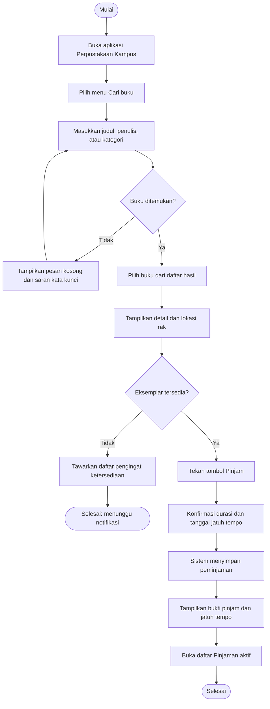

# Dokumen Kebutuhan dan User Flow — Perpustakaan Kampus

**Nama:** Nazwa Aulia Rachma  
**NIM:** 230660221104  
**Domain SI:** Perpustakaan

## 1. Deskripsi aplikasi

**Perpustakaan Kampus** adalah aplikasi mobile yang membantu mahasiswa menemukan buku, memeriksa ketersediaan, mengajukan peminjaman, dan memantau tanggal jatuh tempo tanpa harus mengantre di meja layanan. Pustakawan juga membutuhkan cara yang lebih teratur untuk memperbarui status eksemplar dan menanggapi kebutuhan peminjam. Bentuk mobile dipilih karena mahasiswa biasanya mencari buku atau memeriksa pinjaman ketika sedang berpindah tempat di lingkungan kampus, sedangkan pustakawan membutuhkan pembaruan layanan yang dapat dilakukan langsung dari perangkat kerja.

## 2. User persona

### Persona 1 — Mahasiswa peminjam

| Komponen | Rincian |
|---|---|
| Nama dan peran | **Alya — mahasiswa peminjam** |
| Tujuan | Menemukan buku yang diperlukan, memastikan buku tersedia, mengajukan peminjaman, dan mengetahui tanggal pengembalian. |
| Kendala | Waktu antar-kelas terbatas, katalog sulit ditelusuri secara manual, dan tidak selalu mengetahui apakah buku sedang dipinjam orang lain. |
| Perangkat dan konteks | Ponsel Android saat berada di kelas, lorong kampus, atau perjalanan menuju perpustakaan; koneksi dapat berpindah antara Wi-Fi dan data seluler. |
| Frekuensi penggunaan | Mencari atau memeriksa buku beberapa kali dalam seminggu dan mengajukan peminjaman sekitar 2–4 kali per bulan. |

### Persona 2 — Pustakawan pengelola koleksi

| Komponen | Rincian |
|---|---|
| Nama dan peran | **Rani — pustakawan pengelola koleksi** |
| Tujuan | Menjaga status ketersediaan eksemplar tetap akurat, memproses permintaan peminjaman, dan membantu mahasiswa menemukan koleksi. |
| Kendala | Harus melayani pengguna secara langsung, perubahan status terjadi sepanjang hari, dan pencatatan manual berisiko terlambat atau tidak konsisten. |
| Perangkat dan konteks | Ponsel atau tablet di meja layanan dan area rak saat memeriksa atau memperbarui status koleksi. |
| Frekuensi penggunaan | Menggunakan aplikasi sepanjang jam layanan, terutama saat ada peminjaman, pengembalian, atau pertanyaan tentang koleksi. |

## 3. Kebutuhan fungsional

Setiap kebutuhan berikut memuat satu fungsi dan dapat diuji melalui skenario penggunaan.

| ID | Rumusan kebutuhan | Cara memverifikasi |
|---|---|---|
| F-01 | **Mahasiswa dapat mencari buku berdasarkan judul, penulis, atau kategori dan menerima daftar hasil yang sesuai dengan kata kunci.** | Masukkan kata kunci yang cocok dengan data uji, lalu periksa bahwa hasil menampilkan buku yang relevan dan jumlah hasilnya terlihat. |
| F-02 | **Mahasiswa dapat membuka detail buku dan melihat judul, penulis, kategori, sinopsis singkat, serta lokasi rak.** | Pilih satu hasil pencarian dan periksa seluruh atribut detail tampil pada halaman detail. |
| F-03 | **Mahasiswa dapat melihat status ketersediaan setiap buku dan jumlah eksemplar yang dapat dipinjam.** | Buka detail buku dengan stok tersedia dan stok kosong, lalu bandingkan label status serta jumlah yang ditampilkan. |
| F-04 | **Mahasiswa dapat mengajukan peminjaman buku yang tersedia dan menerima tanggal jatuh tempo setelah konfirmasi.** | Pilih buku tersedia, tekan tombol pinjam, konfirmasi, lalu periksa pesan berhasil dan tanggal jatuh tempo. |
| F-05 | **Mahasiswa dapat melihat daftar pinjaman aktif beserta tanggal jatuh tempo masing-masing buku.** | Buka halaman pinjaman aktif dan cocokkan daftar dengan data peminjaman uji yang belum dikembalikan. |
| F-06 | **Mahasiswa dapat mendaftarkan notifikasi ketika buku yang sedang kosong kembali tersedia.** | Pada buku berstatus kosong, aktifkan pengingat lalu periksa bahwa pengingat tercatat pada profil pengguna. |
| F-07 | **Pustakawan dapat memperbarui status ketersediaan eksemplar setelah peminjaman atau pengembalian diproses.** | Masuk sebagai pustakawan, ubah status satu eksemplar, lalu periksa bahwa status baru terlihat pada katalog. |
| F-08 | **Mahasiswa dapat membayar denda keterlambatan melalui aplikasi.** | Ditunda dari ruang lingkup tugas ini karena memerlukan proses pembayaran dan kebijakan keuangan kampus yang belum ditetapkan. |

## 4. Kebutuhan nonfungsional

| ID | Kategori | Rumusan terukur |
|---|---|---|
| NF-01 | Kinerja | Pada koneksi 4G atau Wi-Fi kampus, 95% permintaan pencarian menampilkan hasil pertama dalam waktu paling lama 2 detik untuk katalog hingga 10.000 judul. |
| NF-02 | Kegunaan | Pengguna baru dapat menemukan satu buku dan menyelesaikan pengajuan peminjaman dalam waktu paling lama 5 menit tanpa bantuan petugas pada uji coba minimal 4 dari 5 peserta. |
| NF-03 | Kompatibilitas | Halaman utama dapat digunakan pada lebar layar 360–1440 piksel tanpa scroll horizontal atau teks yang terpotong. |
| NF-04 | Keamanan | Mahasiswa hanya dapat melihat daftar pinjaman milik akunnya sendiri, sedangkan perubahan status koleksi hanya tersedia pada akun pustakawan. |

## 5. Prioritas MoSCoW

| Prioritas | Kebutuhan | Alasan |
|---|---|---|
| **Must have** | F-01, F-02, F-03, F-04, F-05 | Alur inti Alya dari pencarian sampai pemantauan pinjaman tidak dapat digunakan bila salah satu fungsi ini hilang. Batas Must have adalah lima fitur sesuai ruang lingkup tugas. |
| **Should have** | F-06 | Pengingat membantu Alya mendapatkan buku kosong tanpa mengecek katalog berulang kali, tetapi peminjaman masih dapat berjalan tanpa fitur ini. |
| **Could have** | F-07 | Pembaruan status oleh Rani meningkatkan ketepatan informasi, tetapi pada tahap awal dapat dilakukan melalui prosedur layanan yang sudah berjalan. |
| **Won't have pada versi ini** | F-08 | Pembayaran denda ditunda sampai aturan nominal, verifikasi pembayaran, dan penanggung jawab transaksi ditetapkan oleh kampus. |

## 6. User flow — peminjaman buku oleh mahasiswa

Tujuan alur ini adalah membantu Alya meminjam satu buku yang tersedia. Cabang gagal pada setiap keputusan memiliki tindak lanjut yang jelas.

### Urutan langkah dan keputusan

1. Alya membuka aplikasi.
2. Alya memilih menu **Cari buku**.
3. Alya memasukkan judul, penulis, atau kategori.
4. Sistem memeriksa apakah buku ditemukan (**keputusan 1**).
5. Jika tidak ditemukan, sistem menampilkan pesan kosong dan saran kata kunci, lalu Alya mengulangi pencarian (**cabang gagal 1**).
6. Jika ditemukan, Alya memilih buku dari daftar hasil.
7. Sistem menampilkan detail buku dan lokasi rak.
8. Sistem memeriksa apakah ada eksemplar yang tersedia (**keputusan 2**).
9. Jika kosong, Alya dapat mendaftarkan pengingat dan alur selesai sebagai penantian notifikasi (**cabang gagal 2**).
10. Jika tersedia, Alya menekan **Pinjam**.
11. Alya mengonfirmasi durasi dan tanggal jatuh tempo.
12. Sistem menyimpan peminjaman, menampilkan bukti pinjam, lalu Alya dapat membuka daftar pinjaman aktif.

## 7. Pemetaan kebutuhan ke antarmuka

Widget di bawah merupakan rencana awal yang akan diperhalus pada tahap implementasi berikutnya.

| Kebutuhan | Halaman yang memenuhi | Widget yang direncanakan |
|---|---|---|
| F-01 | Beranda / Cari buku | `Scaffold`, `AppBar`, `TextField`, `DropdownButton`, `ListView.builder` |
| F-02 | Detail buku | `Scaffold`, `AppBar`, `Column`, `Card`, `Text`, `Icon` |
| F-03 | Detail buku | `Card`, `Row`, `Chip`, `LinearProgressIndicator` |
| F-04 | Konfirmasi peminjaman | `Scaffold`, `BottomSheet`, `RadioListTile`, `ElevatedButton`, `AlertDialog` |
| F-05 | Pinjaman aktif | `ListView.builder`, `Card`, `ListTile`, `Chip`, `RefreshIndicator` |
| F-06 | Detail buku kosong / Profil | `SwitchListTile`, `SnackBar`, `FilledButton` |
| F-07 | Panel pustakawan | `DataTable`, `DropdownButton`, `IconButton`, `Form`, `TextFormField` |
| F-08 | Pembayaran denda — ditunda | Belum direncanakan pada versi ini |

## 8. Batasan dan asumsi

- Data katalog dan status eksemplar dianggap tersedia dari sistem perpustakaan kampus.
- Satu akun mahasiswa hanya dapat mengajukan peminjaman sesuai aturan jumlah pinjaman yang berlaku.
- Alur utama berfokus pada peminjaman buku; pengembalian dan pembayaran denda dibahas pada iterasi berikutnya.
- Label dan widget pada pemetaan merupakan rancangan, bukan keputusan final implementasi.
