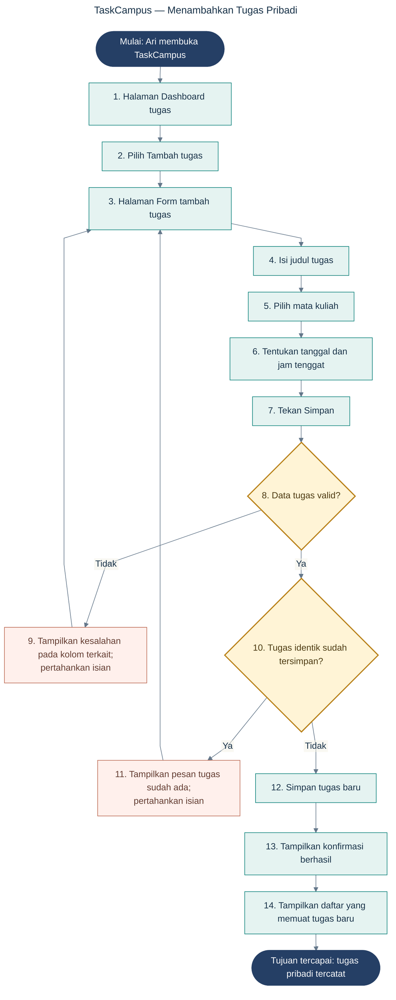
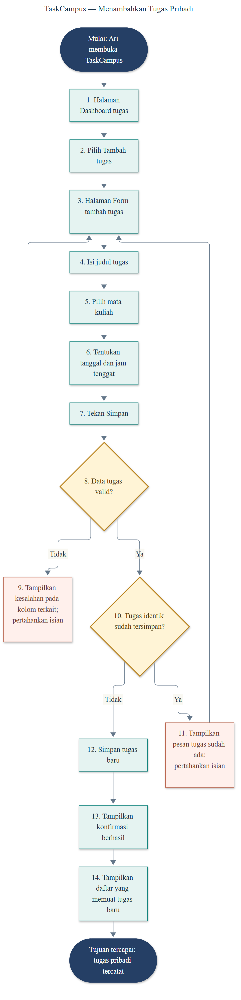

# Dokumen Kebutuhan — TaskCampus

**Nama:** Sharel Faturahman  
**NPM:** 230660221108  
**Kelas:** SI-VIIA  
**Tugas:** 4 — Dokumen Kebutuhan dan User Flow  
**Domain SI:** Pengelolaan tugas akademik mahasiswa.  
**Status:** Rancangan pengembangan berdasarkan domain Tugas 1–3; kriteria penerimaan di bawah merupakan target pengujian.

## 1. Deskripsi Aplikasi

TaskCampus adalah aplikasi mobile untuk membantu mahasiswa mencatat tugas kuliah, memantau tenggat, dan memperbarui progres pengerjaan dalam satu tempat. Masalah yang dihadapi pengguna adalah informasi tugas tersebar pada pesan kelas, catatan pribadi, dan berbagai mata kuliah sehingga tugas dapat terlewat atau tercatat ganda. Mahasiswa menjadi pengguna utama untuk mengelola tugas pribadi, sedangkan koordinator informasi tugas kelas menyediakan pengumuman tugas sebagai referensi bersama. Solusi berbentuk aplikasi mobile dipilih karena mahasiswa dapat memeriksa tugas dalam sesi singkat di sela perpindahan kelas, memasukkan informasi melalui sentuhan, serta mengatur pengingat pada ponsel yang dibawa sehari-hari.

## 2. User Persona

Kedua persona berikut adalah persona rancangan yang mewakili tanggung jawab pengguna, bukan individu nyata atau hasil wawancara. Perbedaan peran memengaruhi kebutuhan fitur dan batas akses; koordinator tidak memperoleh akses ke tugas atau progres pribadi mahasiswa lain.

### Persona 1 — Ari — Mahasiswa

| Komponen | Isi |
|:---------|:----|
| Nama dan peran | Ari — mahasiswa yang mengelola tugas kuliah pribadi. |
| Tujuan | Memiliki daftar tugas yang lengkap, menemukan tugas suatu mata kuliah, dan mengetahui tugas yang belum selesai sebelum tenggat. |
| Kendala | Informasi tersebar pada beberapa percakapan kelas; pencatatan sering dilakukan terburu-buru; tugas berjudul mirip mudah tercatat dua kali. |
| Perangkat dan konteks | Ponsel Android, terutama saat jeda kuliah atau perjalanan antarkelas; koneksi internet dapat terputus sehingga daftar tugas pribadi perlu tetap dapat dibaca. |
| Frekuensi penggunaan | Diasumsikan 3–5 kali per hari, dengan sesi pemeriksaan sekitar 1–2 menit dan pencatatan ketika ada tugas baru. |

### Persona 2 — Nara — Koordinator informasi tugas kelas

| Komponen | Isi |
|:---------|:----|
| Nama dan peran | Nara — koordinator yang bertanggung jawab menerbitkan informasi tugas untuk kelasnya. |
| Tujuan | Menyediakan informasi tugas dan tenggat yang konsisten sebagai referensi seluruh anggota kelas. |
| Kendala | Perubahan tenggat dapat tenggelam dalam percakapan kelas; penyampaian ulang berpotensi menimbulkan informasi yang berbeda. |
| Perangkat dan konteks | Ponsel Android sesudah perkuliahan atau ketika menerima perubahan informasi dari dosen; penerbitan informasi kelas dilakukan saat koneksi tersedia. |
| Frekuensi penggunaan | Diasumsikan 2–4 kali per minggu untuk menerbitkan informasi baru dan setiap kali ada koreksi tenggat. |

## 3. Kebutuhan Fungsional

| ID | Rumusan Kebutuhan | Terkait Persona |
|:---|:------------------|:----------------|
| F-01 | Mahasiswa dapat melihat daftar tugas pribadi yang menampilkan judul, mata kuliah, tenggat, dan status setiap tugas. | Persona 1 |
| F-02 | Mahasiswa dapat menambahkan satu tugas pribadi berstatus awal “Belum dimulai” ketika data valid dan tugas identik belum tersimpan. | Persona 1 |
| F-03 | Mahasiswa dapat mengubah status satu tugas pribadi menjadi “Belum dimulai”, “Dikerjakan”, atau “Selesai” sehingga daftar menampilkan status terbaru. | Persona 1 |
| F-04 | Mahasiswa dapat menyaring daftar tugas pribadi berdasarkan satu mata kuliah sehingga hanya tugas dari mata kuliah terpilih yang ditampilkan. | Persona 1 |
| F-05 | Mahasiswa dapat memperbarui tenggat satu tugas pribadi dengan tanggal dan jam yang valid sehingga daftar menampilkan tenggat terbaru. | Persona 1 |
| F-06 | Mahasiswa dapat menetapkan waktu pengingat untuk satu tugas pribadi sebelum tenggat sehingga pengingat tercatat aktif pada waktu yang dipilih. | Persona 1 |
| F-07 | Koordinator informasi tugas kelas dapat menerbitkan satu informasi tugas untuk kelas yang menjadi tanggung jawabnya sehingga informasi tersebut tercantum pada daftar informasi tugas kelas. | Persona 2 |
| F-08 | Koordinator informasi tugas kelas dapat memperbarui tenggat satu informasi tugas yang diterbitkannya sendiri sehingga daftar informasi kelas menampilkan tenggat terbaru. | Persona 2 |
| F-09 | Mahasiswa dapat melihat ringkasan jumlah seluruh tugas pribadi, tugas aktif, dan tugas selesai berdasarkan status terkini. | Persona 1 |
| F-10 | Mahasiswa dapat mengekspor satu tugas pribadi ke kalender eksternal sehingga terbentuk satu agenda dengan judul dan tenggat yang sama. | Persona 1 |

### Aturan data dan batas peran

- Untuk F-02, judul berisi 1–100 karakter setelah spasi awal dan akhir dihapus, mata kuliah dipilih dari daftar yang tersedia, serta tanggal dan jam tenggat harus valid dan terisi. Tenggat yang sudah lewat tetap diperbolehkan agar mahasiswa dapat mencatat tugas terlambat.
- Tugas identik pada F-02 adalah tugas milik mahasiswa yang sama dengan judul yang sama setelah spasi awal/akhir dihapus dan kapitalisasi diabaikan, mata kuliah yang sama, serta tenggat yang sama sampai ketelitian menit. Catatan tambahan dan status tidak membedakan identitas tugas.
- Penolakan data tidak valid atau duplikat mempertahankan isian formulir dan menampilkan pesan yang menjelaskan bagian yang perlu diperbaiki. Penyimpanan baru dilakukan setelah kedua pemeriksaan lolos.
- Status awal F-02 adalah “Belum dimulai”; tugas aktif pada F-09 meliputi “Belum dimulai” dan “Dikerjakan”, sedangkan tugas selesai berstatus “Selesai”.
- Pembaruan tenggat pada F-05 mengikuti aturan tanggal/jam valid dan tidak boleh menghasilkan kombinasi identik dengan tugas pribadi lain.
- F-06 menerima waktu pengingat yang masih akan datang dan lebih awal daripada tenggat; tugas yang tenggatnya sudah lewat tidak dapat diberi pengingat baru.
- Informasi F-07 memuat judul, mata kuliah, serta tenggat yang valid. Informasi kelas menjadi referensi dan tidak otomatis mengubah tugas pribadi mahasiswa.
- F-08 terbatas pada informasi milik koordinator yang sedang menggunakan aplikasi. Koordinator tidak dapat membaca atau memperbarui catatan serta progres tugas pribadi mahasiswa lain.

### Kriteria verifikasi tiap kebutuhan

Tabel ini menetapkan cara memeriksa fitur saat diimplementasikan, bukan laporan fitur yang sudah selesai diuji.

| ID | Skenario verifikasi yang direncanakan |
|:---|:-------------------------------------|
| F-01 | Siapkan tiga tugas pribadi dengan nilai berbeda; daftar harus menampilkan ketiganya beserta empat informasi yang benar, termasuk saat koneksi dimatikan. |
| F-02 | Simpan tugas dengan data valid dan unik; tepat satu tugas baru muncul berstatus “Belum dimulai”. Judul kosong, mata kuliah belum dipilih, atau tenggat tidak valid harus ditolak tanpa kehilangan isian. Pengiriman ulang kombinasi identik, termasuk variasi kapitalisasi dan spasi pinggir judul, tidak menambah tugas kedua. |
| F-03 | Ubah satu tugas dari “Belum dimulai” menjadi “Dikerjakan” lalu “Selesai”; tugas yang dipilih menampilkan status terakhir dan tugas lain tidak berubah. |
| F-04 | Siapkan dua mata kuliah dengan dua tugas pada masing-masing; pemilihan satu mata kuliah menghasilkan dua tugas dari mata kuliah tersebut. |
| F-05 | Ubah tanggal dan jam tenggat suatu tugas; daftar dan detail menampilkan nilai baru pada tugas itu, sedangkan tugas lain tetap sama. Tanggal/jam tidak valid atau hasil yang identik dengan tugas lain ditolak dengan pesan. |
| F-06 | Pilih waktu pengingat yang akan datang sebelum tenggat; detail tugas menampilkan waktu tersebut dengan status aktif. Waktu yang sudah lewat, tepat pada waktu sekarang, atau tidak lebih awal daripada tenggat ditolak. |
| F-07 | Terbitkan informasi tugas untuk kelas yang menjadi tanggung jawab koordinator; informasi baru muncul satu kali pada kelas yang benar dan daftar pribadi mahasiswa tidak berubah otomatis. |
| F-08 | Perbarui tenggat informasi milik koordinator; informasi itu menampilkan tenggat baru. Percobaan mengubah informasi milik koordinator lain ditolak. |
| F-09 | Siapkan dua tugas “Belum dimulai”, satu “Dikerjakan”, dan satu “Selesai”; ringkasan harus menunjukkan total 4, aktif 3, dan selesai 1. |
| F-10 | Pada pengembangan lanjutan, ekspor satu tugas; kalender tujuan memuat satu agenda dengan judul dan tenggat yang sesuai setelah pengguna menyetujui ekspor. |

## 4. Kebutuhan Nonfungsional

Seluruh kriteria berikut merupakan target penerimaan yang akan diuji pada tahap implementasi.

| ID | Kategori | Rumusan | Kriteria Terukur |
|:---|:---------|:--------|:-----------------|
| NF-01 | Kegunaan | Formulir penambahan tugas dapat dipahami pengguna baru pada sesi penggunaan singkat. | Dalam uji dengan 5 mahasiswa yang belum memakai aplikasi, minimal 4 orang dapat menyimpan satu tugas valid dalam waktu maksimal 90 detik sejak Dashboard tampil, tanpa arahan lisan. |
| NF-02 | Kinerja | Daftar tugas pribadi dapat ditampilkan dalam waktu yang sesuai untuk pemeriksaan singkat. | Pada ponsel Android dengan RAM 4 GB, daftar berisi 100 tugas siap ditelusuri dalam maksimal 2 detik sejak halaman daftar dibuka, dan seluruh catatan dapat diakses melalui gulir; seluruh 5 pengulangan memenuhi batas tersebut ketika koneksi internet dimatikan. |
| NF-03 | Kompatibilitas tampilan | Konten dan aksi utama tetap dapat diakses pada layar ponsel dalam orientasi potret. | Pada viewport logis 360 × 640 dan 390 × 844, tidak muncul indikator overflow atau gulir horizontal; daftar dapat digulir sampai tugas terakhir dan seluruh aksi utama tetap terjangkau. |

## 5. Prioritas Fitur (MoSCoW)

| Prioritas | ID Kebutuhan | Alasan |
|:----------|:-------------|:-------|
| Must have | F-01, F-02, F-03, F-04, F-05 | Lima fungsi ini memungkinkan Ari mencatat, menemukan, dan memantau tugas pribadi beserta status serta tenggatnya, sehingga tujuan utama TaskCampus sudah tercapai pada versi awal. |
| Should have | F-06, F-07, F-08 | Pengingat membantu Ari mengurangi tugas terlewat, sedangkan penerbitan dan koreksi informasi membantu Nara menjaga kesamaan informasi kelas; keduanya bermanfaat setelah pengelolaan tugas pribadi tersedia. |
| Could have | F-09 | Ringkasan mempercepat pemeriksaan Ari, tetapi jumlah dan status masih dapat diketahui dari daftar tugas sehingga fitur ini dapat menyusul setelah kebutuhan utama stabil. |
| Won't have (saat ini) | F-10 | Ekspor kalender ditunda karena tujuan Ari pada versi awal sudah dilayani daftar dan tenggat di dalam aplikasi; pengaturan izin serta kesesuaian agenda kalender akan ditelaah pada pengembangan lanjutan. |

Semua sepuluh kebutuhan memperoleh satu prioritas, dan jumlah Must have adalah lima. Pengelompokan ini merupakan keputusan ruang lingkup; halaman statis Tugas 3 menjadi acuan visual awal dan belum menunjukkan bahwa seluruh kebutuhan telah diimplementasikan.

## 6. Pemetaan Kebutuhan ke Antarmuka

| ID Kebutuhan | Rumusan (ringkas) | Prioritas | Halaman yang Memenuhi | Widget yang Direncanakan (P3) |
|:-------------|:------------------|:----------|:----------------------|:------------------------------|
| F-01 | Melihat daftar tugas pribadi | Must have | Daftar Tugas | `Scaffold` + `AppBar` + `ListView.builder` + `Card` + `ListTile` |
| F-02 | Menambahkan tugas pribadi | Must have | Form Tambah Tugas dan Daftar Tugas setelah berhasil | `Scaffold` + `AppBar` + `Column` + `Card` + `Row` |
| F-03 | Mengubah status tugas | Must have | Detail Tugas | `Scaffold` + `AppBar` + `Column` + `Row` + `Card` |
| F-04 | Menyaring tugas menurut mata kuliah | Must have | Daftar Tugas dengan pilihan mata kuliah | `Scaffold` + `Row` + `Column` + `ListView.builder` + `ListTile` |
| F-05 | Memperbarui tenggat pribadi | Must have | Ubah Tenggat Tugas | `Scaffold` + `AppBar` + `Column` + `Row` |
| F-06 | Menetapkan waktu pengingat | Should have | Pengingat Tugas | `Scaffold` + `AppBar` + `Column` + `Card` + `Row` |
| F-07 | Menerbitkan informasi kelas | Should have | Form Informasi Tugas Kelas dan Daftar Informasi Kelas | `Scaffold` + `AppBar` + `Column` + `Card` + `ListView.builder` |
| F-08 | Memperbarui tenggat informasi kelas | Should have | Detail Informasi Kelas dan Ubah Tenggat Informasi | `Scaffold` + `AppBar` + `Column` + `Row` + `Card` |
| F-09 | Melihat ringkasan tugas | Could have | Dashboard | `Scaffold` + `AppBar` + `Column` + `Row` + `Card` |
| F-10 | Mengekspor tugas ke kalender | Won't have (saat ini) | Rencana halaman Ekspor Kalender pada pengembangan lanjutan | `Scaffold` + `Column` + `Card` + `Row` |

Widget di atas memetakan susunan konten pada tingkat materi Pertemuan 3. Pilihan kontrol masukan, tombol, navigasi, dan detail interaksi akan diperhalus pada Pertemuan 5; pemetaan fitur yang ditunda tetap dicatat sebagai rencana.

### User flow utama

Alur yang dipilih adalah Ari menambahkan satu tugas pribadi sampai tugas baru tersimpan dan terlihat pada daftar. Alur ini menautkan F-02 sebagai aksi utama dan F-01 sebagai kondisi akhir; pengaturan pengingat serta penerbitan informasi kelas merupakan tujuan lain sehingga tidak digabungkan pada diagram ini.

Diagram memuat 14 langkah di luar titik mulai dan tujuan: 12 langkah pada jalur utama, termasuk 2 keputusan, serta 2 langkah penanganan gagal. Isian dipertahankan ketika data tidak valid atau tugas identik ditemukan.

Identitas alur, tabel langkah, dan daftar pemeriksaan diagram lengkap tersedia pada `user-flow.md`; sumber yang dapat diedit tersedia pada `user-flow.mmd`.

## Daftar Pemeriksaan Sebelum Mengumpulkan

- [x] Seluruh teks petunjuk dalam tanda kurung siku telah diganti dengan analisis TaskCampus.
- [x] Setiap persona memuat kelima komponen dan mewakili peran yang berbeda.
- [x] Setiap kebutuhan fungsional mengikuti pola aktor–aksi–hasil dan satu fungsi per pernyataan.
- [x] Kebutuhan nonfungsional memiliki kriteria terukur.
- [x] Seluruh kebutuhan fungsional berprioritas; Must have berjumlah 5.
- [x] Setiap kebutuhan fungsional muncul pada tabel pemetaan.
- [x] Alur memiliki minimal 8 langkah, 2 keputusan, dan cabang gagal yang kembali ke formulir.
- [ ] Alur telah ditelusuri oleh satu teman sekelas dan masukannya dicatat.
- [ ] Penulis telah meninjau serta merumuskan ulang hasil bantuan AI berdasarkan pemahamannya sendiri.

Status peer review teman sekelas: belum dilakukan atau belum ada hasil yang disampaikan. Pemeriksaan konsistensi dokumen tidak dinyatakan sebagai peer review teman sekelas.

Deklarasi penggunaan AI: ChatGPT/Codex — membantu menyusun draf persona, kebutuhan, prioritas, pemetaan antarmuka, serta user flow; hasilnya masih perlu ditinjau dan dirumuskan ulang oleh penulis.
