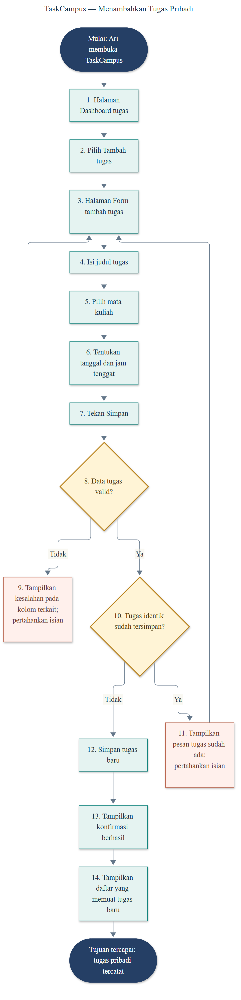

# User Flow — TaskCampus

**Nama:** Sharel Faturahman  
**NPM:** 230660221108  
**Kelas:** SI-VIIA

Dokumen ini merupakan rancangan alur untuk pengembangan TaskCampus setelah halaman statis Tugas 3. Alur belum dinyatakan sebagai fitur yang sudah diimplementasikan.

## 1. Identitas Alur

| Aspek | Isi |
|:------|:----|
| Nama alur | Menambahkan tugas pribadi |
| Aktor | Persona 1 — Ari, mahasiswa pengelola tugas pribadi |
| Tujuan alur | Satu tugas pribadi baru berhasil tersimpan dan muncul pada daftar milik Ari. |

Alur ini mendukung F-02 (menambahkan tugas pribadi) dan berakhir pada daftar yang memenuhi F-01 (melihat daftar tugas pribadi). Persona 2, Nara sebagai koordinator informasi tugas kelas, tidak menjalankan alur ini karena memiliki tujuan dan peran berbeda.

Aturan F-02 yang digunakan pada alur:

- Judul setelah spasi awal/akhir dihapus harus berisi 1–100 karakter; mata kuliah harus dipilih dari daftar mata kuliah yang tersedia; tanggal dan jam tenggat harus merupakan nilai yang valid.
- Tenggat lampau tetap diperbolehkan agar tugas yang sudah terlambat dapat dicatat.
- Tugas dianggap identik jika sudah ada pada daftar mahasiswa yang sama, dengan judul setelah penghapusan spasi awal/akhir dan penyamaan huruf besar/kecil yang sama, mata kuliah yang sama, serta tenggat tanggal dan jam yang sama sampai menit.
- Ketika data tidak valid atau tugas identik ditemukan, sistem menampilkan alasan penolakan dan mempertahankan isian form agar mahasiswa dapat memperbaikinya.

## 2. Diagram User Flow

Diagram berisi 14 langkah di luar titik Mulai dan Tujuan: 12 langkah pada jalur utama, termasuk 2 keputusan, serta 2 langkah penanganan gagal. Kedua keputusan memiliki cabang **Ya** dan **Tidak** yang ditindaklanjuti; cabang gagal kembali ke form, bukan berhenti tanpa arah.

Sumber diagram tersedia pada `user-flow.mmd`. Simbol membedakan titik mulai/tujuan, proses atau halaman, serta keputusan; angka pada diagram sama dengan nomor pada daftar langkah.

## 3. Daftar Langkah

| No. | Jenis | Langkah/Halaman | Bila gagal |
|:---:|:------|:----------------|:-----------|
| S | Mulai | Ari membuka TaskCampus. | — |
| 1 | Halaman | Sistem menampilkan Dashboard tugas pribadi. | — |
| 2 | Aksi | Ari memilih Tambah tugas. | — |
| 3 | Halaman | Sistem menampilkan Form tambah tugas; isian yang sudah diisi dipertahankan jika kembali dari penanganan gagal. | — |
| 4 | Input | Ari mengisi judul tugas. | — |
| 5 | Input | Ari memilih mata kuliah dari daftar yang tersedia. | — |
| 6 | Input | Ari menentukan tanggal dan jam tenggat. | — |
| 7 | Aksi | Ari menekan Simpan. | — |
| 8 | Keputusan | **Data tugas valid? Ya:** lanjut ke langkah 10; **Tidak:** lanjut ke langkah 9. | Tampilkan kesalahan spesifik pada langkah 9. |
| 9 | Pemulihan | Sistem menampilkan kesalahan pada kolom terkait dan mempertahankan seluruh isian. | Kembali ke langkah 3; Ari memperbaiki kolom yang ditandai sebelum menekan Simpan kembali. |
| 10 | Keputusan | **Tugas identik sudah tersimpan? Ya:** lanjut ke langkah 11; **Tidak:** lanjut ke langkah 12. | Tugas identik ditolak dengan pesan pada langkah 11. |
| 11 | Pemulihan | Sistem menampilkan pesan bahwa tugas sudah ada dan mempertahankan seluruh isian. | Kembali ke langkah 3; Ari memperbaiki data tugas yang akan dicatat. |
| 12 | Proses | Sistem menyimpan tugas baru pada daftar milik Ari. | — |
| 13 | Konfirmasi | Sistem menampilkan konfirmasi bahwa tugas berhasil disimpan. | — |
| 14 | Halaman | Sistem menampilkan daftar yang sudah memuat tugas baru. | — |
| T | Tujuan | Tugas pribadi baru tercatat dan terlihat pada daftar milik Ari. | — |

Pada jalur gagal, Ari tidak wajib mengetik ulang semua kolom: perubahan cukup dilakukan pada kolom yang salah atau data yang perlu dibedakan. Pencatatan tugas selesai pada tujuan yang sama, yaitu tugas baru tersimpan; diagram ini tidak mencampurkan alur pengingat atau penerbitan informasi tugas kelas.

## 4. Daftar Pemeriksaan Diagram

- [x] Jumlah langkah minimal 8 di luar titik mulai dan tujuan; diagram ini memuat 14 langkah.
- [x] Jumlah titik keputusan minimal 2; diagram ini memuat keputusan pada langkah 8 dan 10.
- [x] Setiap keputusan memiliki cabang Ya dan Tidak yang keduanya ditindaklanjuti.
- [x] Tidak ada langkah yang buntu; kedua pemulihan kembali ke form dan jalur berhasil berakhir pada tujuan.
- [x] Label setiap langkah menyebut halaman atau tindakan yang dapat ditelusuri tanpa penjelasan lisan.
- [ ] Diagram telah diuji dengan cara ditelusuri oleh satu teman sekelas sesuai Bagian 16 materi.

**Status peer review teman sekelas:** belum dilakukan atau belum ada hasil yang disampaikan. Pemeriksaan struktur oleh ChatGPT/Codex tidak dicatat sebagai pengujian oleh teman sekelas.

Deklarasi penggunaan AI: ChatGPT/Codex — membantu menyusun urutan langkah, cabang keputusan, tabel penelusuran, dan sumber diagram Mermaid; hasilnya masih perlu ditinjau dan dirumuskan ulang oleh penulis.
