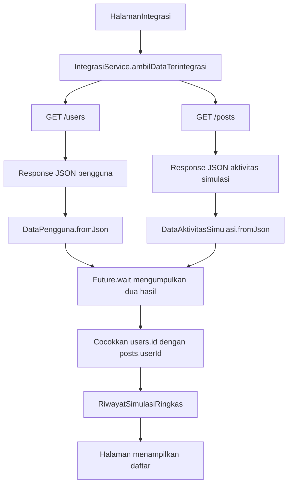
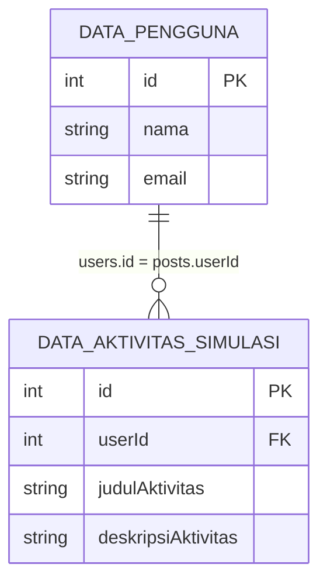
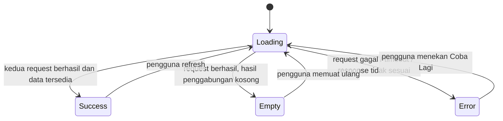

# Diagram Integrasi Data — SI RAKUS Tugas 10

## 1. Diagram Alur Data

## 2. Diagram Relasi Identifier

Keterangan: `users.id` menjadi identifier pengguna, sedangkan `posts.userId` mengacu kepada ID pengguna yang terkait dengan aktivitas simulasi. Satu pengguna dapat memiliki beberapa aktivitas.

## 3. Diagram State Halaman

## 4. Penjelasan `Future.wait`

GET `/users` dan GET `/posts` dijalankan secara bersamaan karena keduanya tidak membutuhkan hasil satu sama lain. Setelah keduanya selesai, service menggabungkan hasilnya menggunakan `users.id` dan `posts.userId`. Jika salah satu request gagal, proses integrasi ditangani sebagai error dan halaman menampilkan pesan serta tombol Coba Lagi.

## 5. Batasan Diagram

Endpoint yang digambarkan merupakan API simulasi JSONPlaceholder. Diagram ini menunjukkan teknik integrasi beberapa endpoint, bukan arsitektur produksi perpustakaan atau koneksi ke Libsys.
