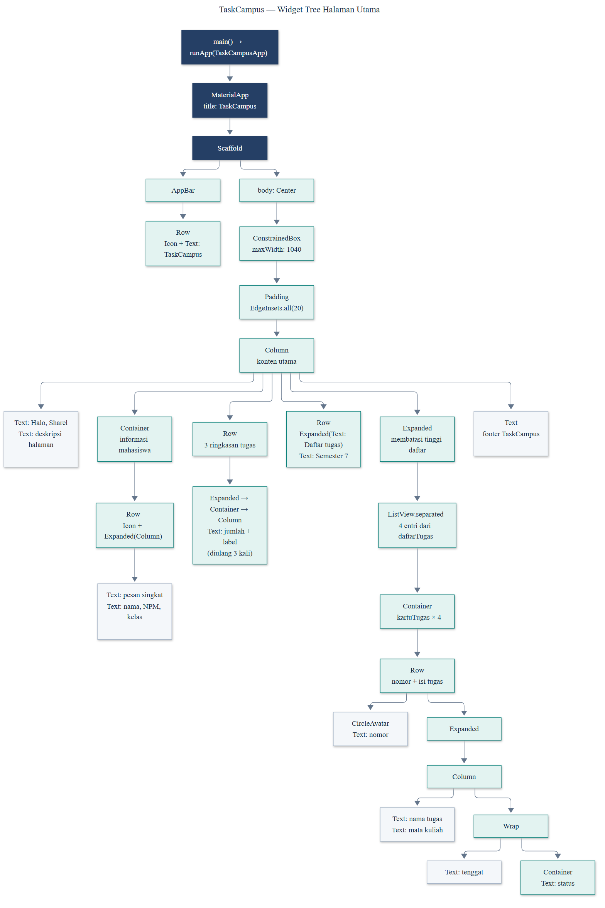

# Tugas 3 - Halaman Aplikasi Sederhana

**Nama:** Sharel Faturahman  
**NPM:** 230660221108  
**Kelas:** SI-VIIA  
**Nama aplikasi:** TaskCampus  
**Domain SI:** Sistem informasi pengelolaan tugas akademik mahasiswa.

## Deskripsi halaman

Halaman utama TaskCampus membantu mahasiswa melihat tugas kuliah dalam satu tempat, melanjutkan domain aplikasi pada Tugas 1. Halaman menampilkan sapaan untuk Sharel, identitas mahasiswa, ringkasan jumlah tugas, serta empat kartu tugas yang memuat nama tugas, mata kuliah, tenggat, dan status pengerjaan. Data tersimpan secara statis di dalam kode dengan kunci `nama`, `mataKuliah`, `tenggat`, dan `status` yang konsisten, tanpa API atau database. Daftar dapat digulir ketika ruang layar terbatas sehingga informasi tetap nyaman dibaca pada browser desktop maupun layar ponsel.

## Struktur dan layout

`halaman_aplikasi.dart` memuat kode Flutter lengkap dengan `main()` dan `TaskCampusApp` berbasis `StatelessWidget`. `MaterialApp` memiliki `title: 'TaskCampus'` serta `home` berupa `Scaffold` dengan `AppBar` dan `body` yang terisi.

| Layout | Penggunaan |
|---|---|
| `Column` | Menyusun sapaan, informasi mahasiswa, ringkasan, judul, daftar, dan footer secara vertikal. |
| `Row` | Menyusun ikon dan judul, tiga ringkasan, serta nomor dan isi kartu tugas. |
| `Padding` | Memberi jarak di sekeliling konten utama. |
| `ListView.separated` | Menampilkan empat entri tugas dengan jarak antarkartu dan mendukung gulir. |

Daftar dibungkus `Expanded` sebagai anak `Column` agar tinggi daftar mengikuti sisa ruang yang tersedia. `Wrap` pada informasi tenggat dan status membantu teks menyesuaikan lebar kartu.

## Berkas pengumpulan

```text
tugas-3/230660221108-SharelFaturahman/
├── halaman_aplikasi.dart
├── screenshot-halaman.png
├── widget-tree.png
├── widget-tree.mmd
└── README.md
```

`widget-tree.mmd` adalah sumber diagram Mermaid yang dapat dibuka di [Mermaid Live Editor](https://mermaid.live/). `widget-tree.png` merupakan ekspor diagram tersebut dan mengikuti hierarki widget pada kode; widget dekoratif berulang diringkas sesuai keterangan pada sumber.

## Menjalankan halaman dari folder web khusus

Folder Flutter yang dapat dipakai kembali untuk tugas selanjutnya tersedia di `D:\KULIAH\semester 7\sharel\web_flutter`. Kode Tugas 3 sudah terpasang di `lib/main.dart` dan identik dengan `halaman_aplikasi.dart` pada folder tugas ini.

Buka Command Prompt dan jalankan:

```cmd
cd /d "D:\KULIAH\semester 7\sharel\web_flutter"
jalankan.cmd
```

Chrome akan membuka halaman **TaskCampus**. Biarkan CMD tetap terbuka, lalu ambil screenshot sendiri dari jendela Chrome dengan judul tab dan alamat `localhost` terlihat. Ketik `q` pada CMD untuk menghentikan aplikasi.

## Status screenshot

`screenshot-halaman.png` saat ini adalah PNG putih kosong sebagai tempat menyimpan screenshot yang akan diambil sendiri. Berkas ini belum berisi tampilan aplikasi dan bukan bukti eksekusi. Setelah halaman terbuka di Chrome, ganti PNG tersebut dengan hasil screenshot Anda sendiri, menggunakan nama berkas yang sama.

## Pemakaian folder web untuk tugas berikutnya

Ganti kode `lib/main.dart` pada folder web khusus dengan kode Flutter lengkap untuk tugas berikutnya, lalu jalankan `jalankan.cmd` dari folder yang sama. Perubahan pada folder web tidak otomatis mengubah sumber kode di folder pengumpulan; salin kode akhir ke folder tugas yang sesuai setelah selesai.

## Widget tree



## Refleksi

Widget layout yang paling sulit saya rangkai adalah `ListView.separated` di dalam `Column` karena keduanya perlu batas tinggi yang jelas. Saya membungkus daftar dengan `Expanded` agar memakai sisa ruang tanpa menyebabkan overflow. Susunan ini membuat bagian ringkasan tetap terlihat sementara daftar tugas dapat digulir.

## Acuan

- Panduan Tugas 3 yang diberikan pada percakapan.
- [Materi PAB Pertemuan 3](https://github.com/PBWFEND/PAB/blob/main/pertemuan-03/03-Pertemuan-3.md).

Bantuan ChatGPT/Codex dicantumkan secara jujur pada komentar kode.
