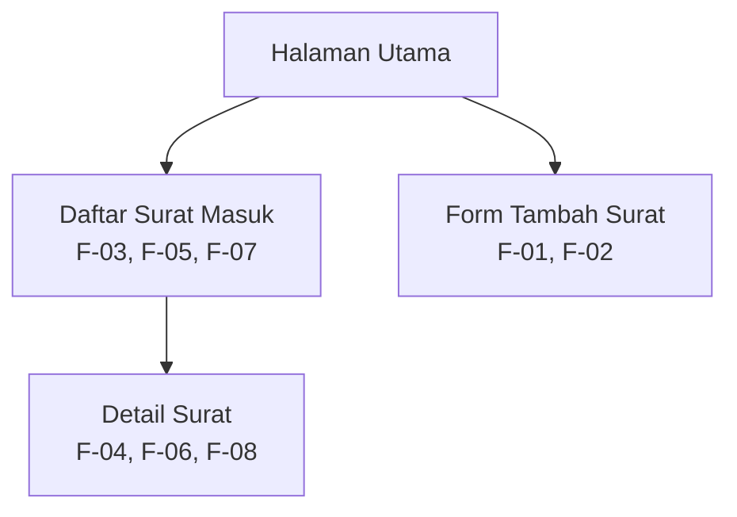

# Information Architecture — Pengelolaan Surat Masuk UKM

## 1. Inventaris Halaman

| No. | Nama Halaman | Fungsi | Kebutuhan Terkait |
|---|---|---|---|
| 1 | Halaman utama | Menjadi halaman awal untuk mengakses daftar surat masuk. | F-03 |
| 2 | Daftar surat masuk | Menampilkan daftar surat masuk, status pemeriksaan, dan kolom pencarian surat. | F-03, F-05, F-07 |
| 3 | Detail surat | Menampilkan informasi surat yang dipilih dan menyediakan tindakan untuk menandai surat sudah diperiksa. | F-04, F-06, F-08 |
| 4 | Form tambah surat | Memungkinkan anggota atau pengurus UKM mencatat informasi surat masuk dan pengirimnya. | F-01, F-02 |

## 2. Diagram Information Architecture

## 3. Penjelasan Struktur

Halaman utama menjadi titik awal pengguna untuk mengakses daftar surat masuk dan form tambah surat. Halaman daftar surat digunakan sekretaris untuk melihat surat yang telah dicatat, mengetahui status pemeriksaannya, dan mencari surat berdasarkan kata kunci. Dari daftar tersebut, pengguna dapat membuka detail surat untuk melihat informasi yang diperlukan dan menandai surat sebagai sudah diperiksa. Form tambah surat digunakan anggota atau pengurus UKM untuk mencatat informasi surat masuk beserta informasi pengirimnya.

Struktur ini mengutamakan kebutuhan Must-have, yaitu pencatatan surat (F-01), melihat daftar surat (F-03), melihat detail surat (F-04), dan menandai surat sudah diperiksa (F-06).

## 4. Catatan Cakupan

Pencarian surat (F-05) dan akses anggota untuk melihat informasi surat yang telah dicatat (F-08) termasuk dalam kebutuhan aplikasi. Pada prototipe ini, pencarian ditampilkan pada halaman daftar surat, sedangkan akses untuk melihat informasi surat dicakup melalui halaman detail. Implementasi fitur secara menyeluruh dapat disesuaikan dengan prioritas dan cakupan tugas. Diagram ini menggambarkan struktur halaman, bukan seluruh langkah interaksi pengguna.
