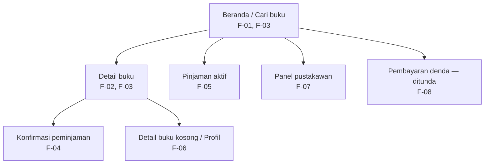

# Information Architecture — Perpustakaan Kampus

**Nama:** Nazwa Aulia Rachma  
**NIM:** 230660221104

## Inventaris layar

| Layar | Peran dalam aplikasi | ID kebutuhan yang dipenuhi |
|---|---|---|
| **Beranda / Cari buku** | Layar utama untuk mencari koleksi dan melihat status singkat buku. | F-01, F-03 |
| **Detail buku** | Menampilkan informasi lengkap buku dan lokasi rak. | F-02, F-03 |
| **Konfirmasi peminjaman** | Memastikan durasi dan tanggal jatuh tempo sebelum peminjaman disimpan. | F-04 |
| **Pinjaman aktif** | Menampilkan buku yang sedang dipinjam dan tanggal jatuh temponya. | F-05 |
| **Detail buku kosong / Profil** | Tempat mahasiswa mengaktifkan pengingat untuk buku yang belum tersedia. | F-06 |
| **Panel pustakawan** | Tempat pustakawan memperbarui status eksemplar koleksi. | F-07 |
| **Pembayaran denda — ditunda** | Layar yang dicatat untuk iterasi berikutnya dan belum dibangun pada versi ini. | F-08 |

## Diagram information architecture

## Alasan layar utama

**Beranda / Cari buku** ditetapkan sebagai layar utama karena langsung memenuhi F-01 dan F-03, dua kebutuhan Must have yang menjadi pintu masuk alur peminjaman. Dari layar ini pengguna dapat menemukan koleksi dan memeriksa statusnya sebelum melanjutkan ke layar pendukung pada iterasi berikutnya.

## Prinsip struktur

- Layar yang berhubungan dengan pencarian dan pemeriksaan koleksi diletakkan paling dekat dengan layar utama.
- `Pinjaman aktif` tetap terlihat sebagai tujuan utama kedua bagi persona mahasiswa setelah peminjaman berhasil.
- `Panel pustakawan` ditandai sebagai layar pendukung untuk persona pustakawan, bukan bagian dari alur mahasiswa.
- `Pembayaran denda — ditunda` dicatat agar kebutuhan F-08 tetap terlacak meskipun belum masuk versi prototype.
