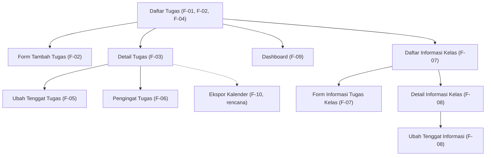

# Information Architecture — TaskCampus

**Sharel Faturahman · 230660221108 · SI-VIIA**

## Inventaris layar

Inventaris mengikuti Bagian 6, Pemetaan Kebutuhan ke Antarmuka, pada dokumen Tugas 4.

| Layar | ID kebutuhan | Fungsi |
|---|---|---|
| **Daftar Tugas** | **F-01, F-02, F-04** | Menampilkan judul, mata kuliah, tenggat, dan status tugas pribadi (F-01). Daftar memuat tugas baru setelah penambahan berhasil (F-02) dan menyediakan pilihan mata kuliah (F-04). |
| Form Tambah Tugas | F-02 | Menerima judul, mata kuliah, serta tanggal dan jam tenggat untuk satu tugas pribadi. |
| Detail Tugas | F-03 | Menampilkan tugas yang dipilih dan menyediakan perubahan statusnya. |
| Ubah Tenggat Tugas | F-05 | Memperbarui tanggal dan jam tenggat tugas pribadi. |
| Pengingat Tugas | F-06 | Menetapkan waktu pengingat sebelum tenggat. |
| Daftar Informasi Kelas | F-07 | Menampilkan informasi tugas yang diterbitkan untuk kelas. |
| Form Informasi Tugas Kelas | F-07 | Menerima informasi tugas baru dari koordinator kelas. |
| Detail Informasi Kelas | F-08 | Menampilkan informasi terpilih dan menyediakan akses untuk mengubah tenggat bagi koordinator yang menerbitkannya. |
| Ubah Tenggat Informasi | F-08 | Memperbarui tenggat informasi yang diterbitkan koordinator. |
| Dashboard | F-09 | Menampilkan jumlah seluruh tugas pribadi, tugas aktif, dan tugas selesai. |
| Ekspor Kalender | F-10 | Rencana layar untuk mengirim satu tugas pribadi ke kalender eksternal pada pengembangan lanjutan. |

## Diagram IA

Panah menggambarkan hubungan antarhalaman dalam rancangan. Garis putus-putus menandai fitur yang ditunda pada Tugas 4. Ari mengelola tugas pribadinya, sedangkan penerbitan dan perubahan informasi kelas berlaku bagi Nara sebagai koordinator.

## Alasan memilih Daftar Tugas

Daftar Tugas menjadi layar utama karena memenuhi kebutuhan Must have F-01 dan F-04, yaitu membantu Ari memeriksa tugas pribadi dan menemukannya berdasarkan mata kuliah. Layar ini juga menjadi tempat Ari melihat tugas baru setelah penambahan berhasil (F-02), sesuai akhir alur pada Tugas 4.
