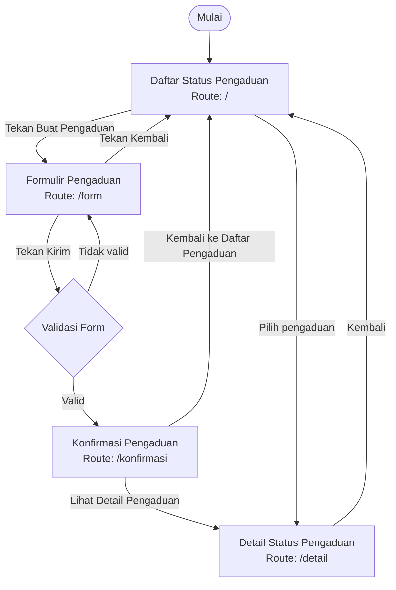

# Navigation Flow — SI-FASKAM

## 1. Identitas Aplikasi

| Aspek | Keterangan |
|---|---|
| Nama aplikasi | SI-FASKAM |
| Nama sistem | Sistem Informasi Pengaduan Fasilitas Kampus |
| Aktor | Mahasiswa |
| Tujuan | Memudahkan mahasiswa mengirim pengaduan dan memantau status fasilitas kampus |
| Platform | Flutter |
| Metode navigasi | Navigator dengan named routes |

## 2. Daftar Route

| No. | Nama Route | Nama Layar | Kebutuhan yang Dipenuhi | Keterangan |
|---|---|---|---|---|
| 1 | `/` | Daftar Status Pengaduan | F-01, F-04 | InitialRoute atau halaman utama |
| 2 | `/form` | Formulir Pengaduan | F-02, F-03 | Halaman untuk membuat pengaduan |
| 3 | `/konfirmasi` | Konfirmasi Pengaduan | F-04, F-05 | Halaman informasi hasil pengiriman |
| 4 | `/detail` | Detail Status Pengaduan | F-06 | Halaman informasi detail pengaduan |

Catatan: ID kebutuhan F-01 sampai F-06 merupakan pemetaan sementara dan perlu disesuaikan dengan tabel kebutuhan fungsional Tugas 4 serta pemetaan antarmuka Tugas 5.

## 3. Diagram Navigation Flow

Diagram berikut menggambarkan alur perpindahan halaman pada aplikasi SI-FASKAM.

### Penjelasan Alur Navigasi

1. Mahasiswa membuka aplikasi dan masuk ke halaman Daftar Status Pengaduan.
2. Pada halaman utama, mahasiswa dapat melihat daftar pengaduan yang tersedia.
3. Mahasiswa menekan tombol untuk membuat pengaduan baru sehingga aplikasi membuka halaman Formulir Pengaduan.
4. Mahasiswa memilih kategori fasilitas, mengisi lokasi, dan menuliskan deskripsi masalah.
5. Setelah menekan tombol Kirim, sistem melakukan validasi terhadap data yang dimasukkan.
6. Jika data belum valid, sistem menampilkan pesan kesalahan pada kolom yang perlu diperbaiki dan mahasiswa tetap berada di halaman formulir.
7. Jika seluruh data valid, sistem membuat objek pengaduan dan membuka halaman Konfirmasi Pengaduan.
8. Pada halaman konfirmasi, mahasiswa dapat memilih untuk melihat detail pengaduan atau kembali ke daftar pengaduan.
9. Halaman Detail Status Pengaduan menampilkan informasi pengaduan yang dipilih.
10. Mahasiswa dapat kembali ke halaman sebelumnya menggunakan tombol kembali.

## 4. Pengiriman Data Antarlayar

Pengiriman data antarlayar dilakukan menggunakan parameter `arguments` pada metode `Navigator.pushNamed`.

Aplikasi menggunakan model `Pengaduan` sebagai objek untuk menyimpan informasi pengaduan yang dikirimkan antarlayar.

Data yang terdapat pada model `Pengaduan` meliputi:

1. Kategori fasilitas.
2. Lokasi pengaduan.
3. Deskripsi masalah.
4. Status pengaduan.

### Proses Pengiriman Data

**a. Formulir Pengaduan ke Konfirmasi Pengaduan**

Setelah mahasiswa mengisi formulir dengan benar dan menekan tombol Kirim, sistem membuat objek `Pengaduan`. Objek tersebut kemudian dikirim ke halaman Konfirmasi Pengaduan menggunakan `Navigator.pushNamed` dengan parameter `arguments`.

**b. Konfirmasi Pengaduan ke Detail Status Pengaduan**

Mahasiswa dapat menekan tombol Lihat Detail Pengaduan. Sistem mengirimkan objek `Pengaduan` ke halaman Detail Status Pengaduan untuk menampilkan informasi pengaduan.

**c. Daftar Status Pengaduan ke Detail Status Pengaduan**

Mahasiswa dapat memilih salah satu pengaduan yang tersedia pada daftar. Sistem mengirimkan objek pengaduan yang dipilih ke halaman Detail Status Pengaduan.

### Pemeriksaan Data

Pada halaman yang menerima data, aplikasi melakukan pemeriksaan tipe menggunakan operator `is` untuk memastikan bahwa data yang diterima merupakan objek `Pengaduan`.

Apabila data tidak tersedia atau tidak sesuai dengan tipe yang diharapkan, aplikasi menampilkan tampilan pengganti agar halaman tetap dapat dibuka.

Informasi pada halaman Detail Status Pengaduan bersifat *read-only*, sehingga mahasiswa hanya dapat melihat informasi pengaduan dan tidak dapat mengubah status pengaduan melalui halaman tersebut.

## 5. Alasan Pemilihan InitialRoute

Halaman Daftar Status Pengaduan dipilih sebagai `initialRoute` dengan menggunakan route `/`.

Pemilihan halaman ini didasarkan pada beberapa alasan berikut:

1. Halaman Daftar Status Pengaduan merupakan halaman utama aplikasi SI-FASKAM.
2. Mahasiswa dapat langsung melihat daftar pengaduan beserta statusnya.
3. Mahasiswa dapat mengakses fitur pembuatan pengaduan baru melalui halaman utama.
4. Halaman utama menjadi pusat navigasi untuk menuju halaman formulir dan detail pengaduan.

Dengan demikian, penggunaan halaman Daftar Status Pengaduan sebagai `initialRoute` memudahkan mahasiswa dalam mengakses fitur utama aplikasi.

## 6. Implementasi Navigasi pada Flutter

Implementasi navigasi aplikasi SI-FASKAM menggunakan fitur bawaan Flutter, yaitu `Navigator` dan named routes.

Metode navigasi yang digunakan meliputi:

| Metode | Fungsi |
|---|---|
| `Navigator.pushNamed()` | Membuka halaman baru berdasarkan nama route. |
| `Navigator.pop()` | Kembali ke halaman sebelumnya dan dapat mengirimkan data hasil. |
| `arguments` | Mengirimkan objek pengaduan ke halaman tujuan. |
| `initialRoute` | Menentukan halaman pertama yang ditampilkan ketika aplikasi dijalankan. |

Daftar route didefinisikan pada konfigurasi `MaterialApp`, sehingga setiap halaman dapat diakses menggunakan nama route yang telah ditentukan.

## 7. Kesimpulan

Navigation Flow aplikasi SI-FASKAM terdiri dari empat route utama, yaitu Daftar Status Pengaduan, Formulir Pengaduan, Konfirmasi Pengaduan, dan Detail Status Pengaduan.

Setiap halaman memiliki fungsi yang saling berhubungan dalam mendukung proses pengaduan fasilitas kampus. Penggunaan named routes, `Navigator.pushNamed()`, `Navigator.pop()`, dan `arguments` memudahkan perpindahan halaman serta pengiriman data pengaduan antarlayar.

Alur navigasi dirancang agar mahasiswa dapat membuat pengaduan, mendapatkan informasi konfirmasi, dan melihat detail status pengaduan dengan mudah.