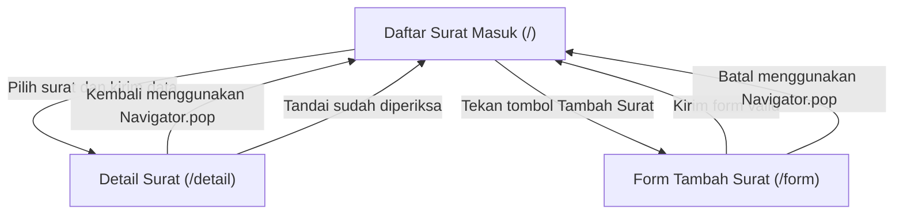

# Navigation Flow — Pengelolaan Surat Masuk UKM

## 1. Daftar Route

| Nama Route | Layar | Kebutuhan yang Dipenuhi | Initial Route |
|---|---|---|---|
| `/` | Daftar Surat Masuk | F-03: Sekretaris melihat daftar surat masuk; F-05: mencari surat; F-07: melihat status pemeriksaan | Ya |
| `/detail` | Detail Surat | F-04: Sekretaris melihat detail surat; F-06: menandai surat sudah diperiksa; F-08: melihat informasi surat | Tidak |
| `/form` | Form Tambah Surat | F-01: mencatat informasi surat masuk; F-02: mengisi informasi pengirim | Tidak |

## 2. Diagram Alur Navigasi

## 3. Alasan Pemilihan Initial Route

Route `/` dipilih sebagai initialRoute karena halaman Daftar Surat Masuk merupakan halaman awal yang telah dibuat pada Tugas 5. Halaman ini memenuhi kebutuhan F-03 dan menjadi titik awal bagi pengguna untuk membuka detail surat atau menuju form pencatatan surat baru.