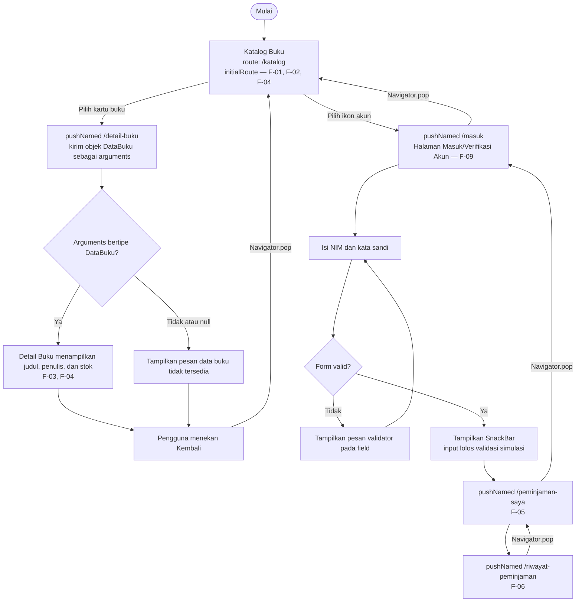

# Navigation Flow — SI RAKUS

## 1. Deskripsi

Navigation Flow SI RAKUS disusun dari Information Architecture Tugas 5. Alur utama yang dihubungkan pada Tugas 6 adalah mahasiswa membuka Katalog Buku, memilih salah satu buku, melihat Detail Buku, lalu kembali ke Katalog Buku. Data buku dikirim dari layar katalog ke layar detail menggunakan `arguments`. Selain alur utama tersebut, rancangan ini menyediakan alur Masuk/Verifikasi Akun menuju Peminjaman Saya dan Riwayat Peminjaman sesuai layar yang telah tercatat pada IA.

## 2. Daftar Route

Nama layar dan kebutuhan pada tabel ini mengikuti IA Tugas 5. Nama route harus ditulis sama persis pada diagram dan peta `routes` dalam kode Flutter.

| No. | Nama route | Nama layar pada IA Tugas 5 | Kebutuhan | Keterangan |
|---:|---|---|---|---|
| 1 | `/katalog` | Katalog Buku | F-01, F-02, F-04, F-08 | `initialRoute`; titik awal mahasiswa untuk melihat dan mencari buku. |
| 2 | `/detail-buku` | Detail Buku | F-03, F-04 | Dibuka dari Katalog Buku; menerima objek buku melalui `arguments`. |
| 3 | `/masuk` | Halaman Masuk/Verifikasi Akun | F-09 | Memuat form NIM dan kata sandi dengan validasi. |
| 4 | `/peminjaman-saya` | Peminjaman Saya | F-05 | Menampilkan informasi peminjaman aktif milik mahasiswa setelah identitas diverifikasi. |
| 5 | `/riwayat-peminjaman` | Riwayat Peminjaman | F-06 | Menampilkan riwayat peminjaman milik mahasiswa. |

F-07 tidak dibuat sebagai route karena pada Tugas 4 kebutuhan tersebut ditetapkan *Won't have* untuk antarmuka mobile mahasiswa.

## 3. Diagram Navigation Flow

Diagram berikut menunjukkan alur utama Must have (Katalog Buku → Detail Buku), pengiriman data buku, dan cara kembali. Cabang masuk akun juga dicantumkan karena form dan validasi merupakan komponen wajib Tugas 6.

**Catatan:** validasi form hanya memeriksa kelengkapan/format input pada prototype. Karena belum ada backend atau database akun, `SnackBar` tidak boleh menyatakan bahwa kredensial benar-benar telah diverifikasi oleh sistem perpustakaan. Teks feedback yang disarankan adalah “Input memenuhi validasi (simulasi). Verifikasi akun sebenarnya belum terhubung.”

## 4. Pengiriman Data Antarlayar

Saat mahasiswa memilih kartu buku pada Katalog Buku, aplikasi membuka route `/detail-buku` menggunakan `Navigator.pushNamed`. Objek `DataBuku` dikirim melalui parameter `arguments`. Pada layar Detail Buku, data dibaca melalui `ModalRoute.of(context)?.settings.arguments`, kemudian diperiksa menggunakan `is DataBuku`. Jika objek tidak tersedia atau tipenya tidak sesuai, layar menampilkan pesan pengganti dan tidak melakukan cast paksa.

Arah pengiriman data pada prototype ini adalah satu arah, yaitu Katalog Buku menuju Detail Buku. Layar detail hanya menampilkan informasi buku yang dipilih.

## 5. Alasan Pemilihan `initialRoute`

Route `/katalog` dipilih sebagai `initialRoute` karena Katalog Buku merupakan titik awal mahasiswa untuk melihat daftar koleksi (F-01) dan melakukan pencarian (F-02), dua kebutuhan berprioritas *Must have*. Dari layar ini mahasiswa dapat meneruskan tugas utama dengan memilih buku untuk melihat detail dan ketersediaan stoknya (F-03 dan F-04).

## 6. Ketentuan Implementasi

- Gunakan nama route yang sama persis pada tabel, diagram, `MaterialApp.routes`, dan setiap pemanggilan `Navigator.pushNamed`.
- Gunakan `Navigator.pushNamed` untuk membuka layar baru dan `Navigator.pop` untuk kembali.
- Jangan memasang tombol `pop` pada Katalog Buku karena merupakan route awal.
- Periksa `arguments` dengan `is DataBuku` dan sediakan cabang `null`/tipe tidak sesuai.
- Gunakan `Form` dan `GlobalKey<FormState>` pada Halaman Masuk/Verifikasi Akun.
- Setiap `TextFormField` harus memiliki validator. Controller harus dibersihkan di `dispose`.
- Tampilkan `SnackBar` setelah form valid dikirim. Tandai hasilnya sebagai simulasi, bukan autentikasi nyata.
