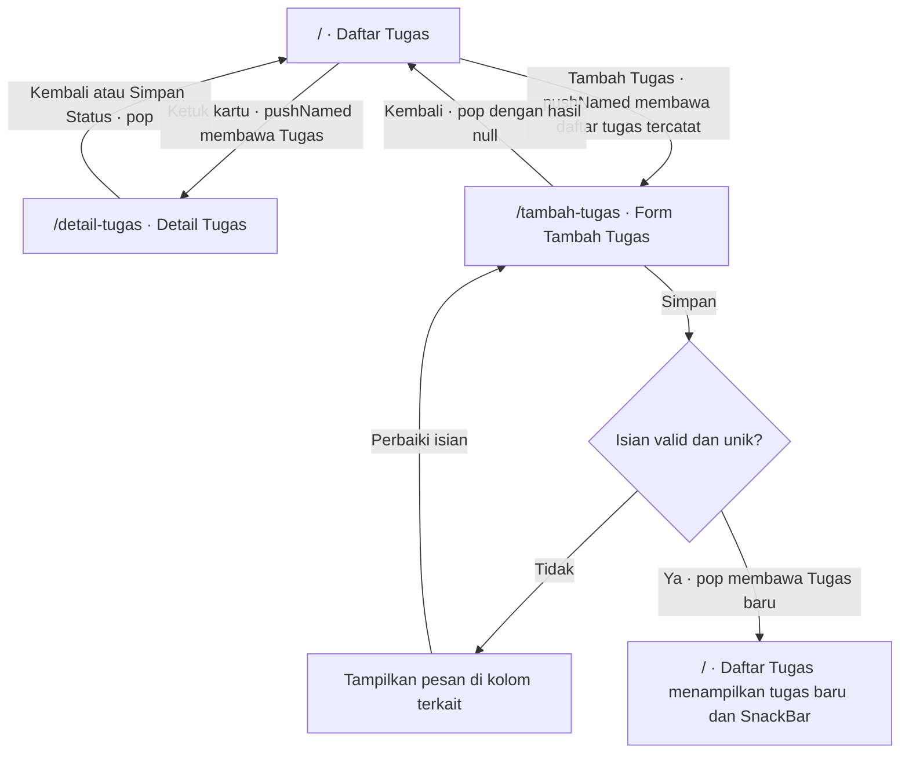

# Navigation Flow — TaskCampus

**Sharel Faturahman · 230660221108 · SI-VIIA**

## Daftar route

Nama layar mengikuti Information Architecture Tugas 5. Alur utama Pertemuan 6 adalah mencatat satu tugas pribadi (F-02).

| Nama route | Layar | Kebutuhan | `initialRoute` |
|---|---|---|---|
| `/` | Daftar Tugas | F-01 untuk melihat tugas pribadi, F-02 untuk melihat tugas yang baru disimpan, F-04 untuk menyaring berdasarkan mata kuliah. | Ya |
| `/detail-tugas` | Detail Tugas | F-03 untuk membaca status dan menyimpan perubahan status tugas yang dipilih. | |
| `/tambah-tugas` | Form Tambah Tugas | F-02 untuk memasukkan, memvalidasi, dan mengirim satu tugas baru. | |

## Diagram alur

Pada alur F-02, form menerima daftar tugas tercatat sebagai acuan pengecekan duplikat. Setelah simpan berhasil, daftar menambahkan objek `Tugas` yang dikembalikan oleh form dengan status **Belum dimulai**. Pada alur F-03, **Simpan Status** mengembalikan nilai `StatusTugas` untuk memperbarui kartu yang dibuka dari daftar.

## Alasan memilih `initialRoute`

Rute `/` membuka **Daftar Tugas** sehingga mahasiswa dapat langsung melihat tugas pribadi (F-01) dan menyaringnya berdasarkan mata kuliah (F-04), dua kebutuhan Must have. Layar yang sama menyediakan pintu masuk **Tambah Tugas** dan langsung menampilkan hasil penyimpanan (F-02).
