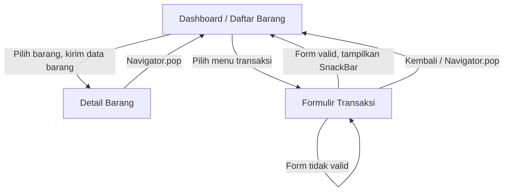

# Navigation Flow — Aplikasi Inventaris Barang

## 1. Daftar Rute

| Nama Rute | Halaman | ID Kebutuhan | Initial Route |
|---|---|---|---|
| `/` | Dashboard / Daftar Barang | F-03 | Ya |
| `/detail` | Detail Barang | F-03 | Tidak |
| `/form` | Formulir Transaksi | F-02 | Tidak |

## 2. Alur Navigasi

## 3. Penjelasan Navigasi

### Dashboard / Daftar Barang

Halaman awal menampilkan daftar barang inventaris. Pengguna dapat memilih barang untuk melihat detail atau membuka formulir transaksi.

### Detail Barang

Halaman detail menerima data barang melalui `Navigator.pushNamed` menggunakan parameter `arguments`. Data diperiksa terlebih dahulu menggunakan pengecekan tipe `is`. Jika data tidak sesuai atau tidak tersedia, halaman menampilkan pesan alternatif.

Pengguna dapat kembali ke dashboard menggunakan `Navigator.pop`.

### Formulir Transaksi

Halaman formulir menyediakan input transaksi dengan validasi pada setiap kolom. Jika data belum valid, pengguna tetap berada di formulir dan menerima pesan kesalahan. Jika data valid, aplikasi menampilkan `SnackBar` sebagai umpan balik.

Pengguna dapat kembali ke dashboard menggunakan `Navigator.pop`.

## 4. Alasan Memilih Initial Route

Rute `/` dipilih sebagai `initialRoute` karena dashboard merupakan titik awal untuk melihat daftar barang dan mengakses fungsi lain. Struktur ini membantu pengguna memahami pilihan yang tersedia sebelum membuka detail barang atau melakukan transaksi.