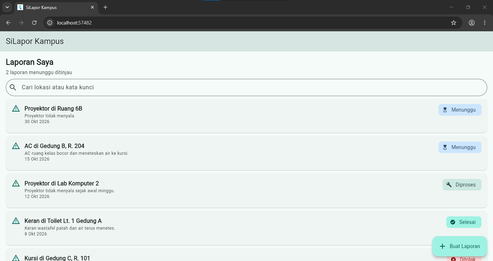
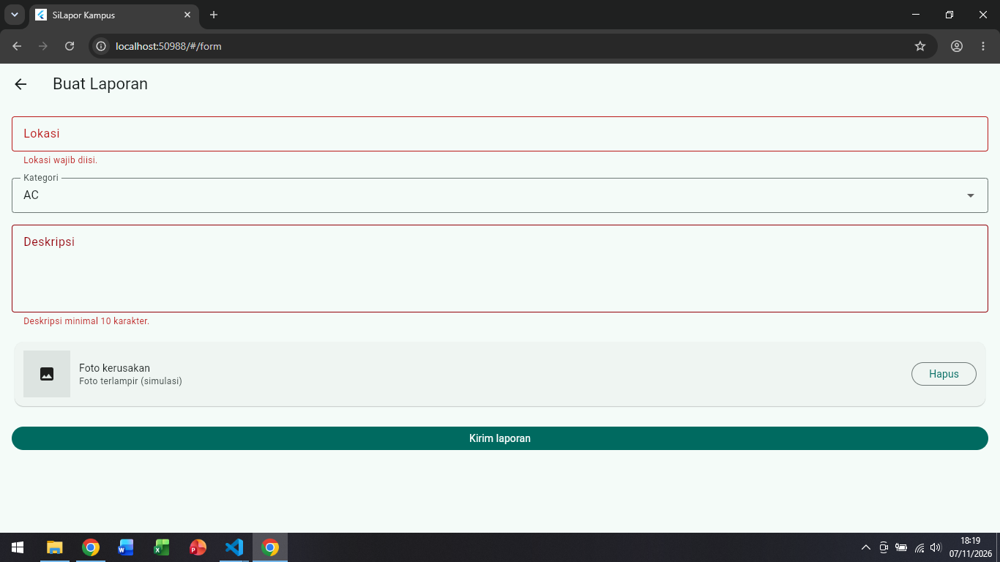
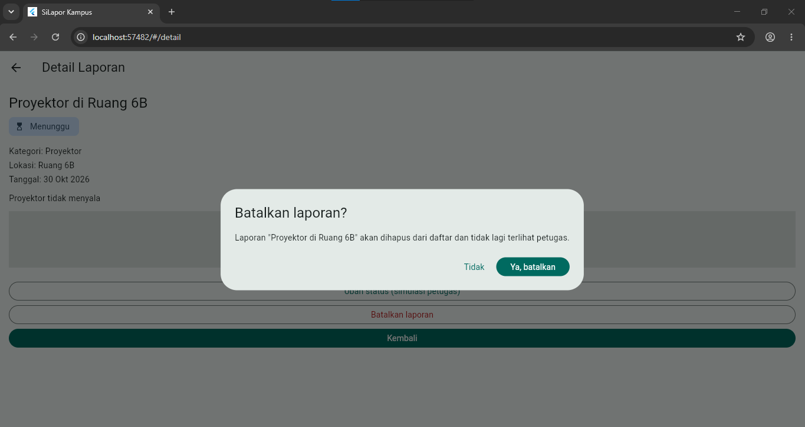

# Laporan Progress Project UTS (Milestone M4)

| | |
|:--|:--|
| **Nama** | Galih Permana Sidik |
| **NIM** | 230660221002 |
| **Kelas** | SI-VIIA |
| **Domain SI** | Pelaporan kerusakan fasilitas kampus (sarana dan prasarana) |
| **Judul Aplikasi** | SiLapor Kampus |
---

## 1. Ringkasan Eksekutif Project

SiLapor Kampus menyelesaikan masalah yang sederhana tetapi berulang: kerusakan proyektor, AC, keran, atau kursi di kampus biasanya dilaporkan lewat pesan berantai atau lisan. Laporan itu mudah terlewat, sering terkirim ganda oleh orang berbeda, dan pelapor tidak pernah tahu apakah laporannya sudah ditangani. Aplikasi ini memberi satu tempat untuk membuat laporan, melihat laporan serupa sebelum mengirim, dan memantau statusnya sampai selesai.

Pengguna utamanya Dina, mahasiswa pelapor yang menemukan kerusakan di sela jadwal kuliah dan hanya punya beberapa menit, serta Pak Asep, petugas sarana dan prasarana yang menerima laporan dari banyak jalur. Solusi mobile dipilih karena kerusakan ditemukan di lokasi, tepat saat pelapor memegang ponsel. Web desktop menuntut pelapor kembali ke komputer, dan cara manual tidak meninggalkan status yang bisa dilacak. Prototype saat ini mengikuti alur Dina; sisi petugas menunggu data bersama dari backend.

## 2. Ketercapaian Milestone (M1 s.d. M3)

| Milestone | Deliverable | Status (Selesai / Sebagian) | Catatan / Bukti |
|:----------|:------------|:----------------------------|:----------------|
| M1: Kebutuhan | Dokumen kebutuhan + User Flow | Selesai | `dokumen-kebutuhan.md` (Tugas 4): 2 persona, 10 kebutuhan fungsional, 3 kebutuhan nonfungsional, prioritas MoSCoW, user flow membuat laporan |
| M2: UI/UX | Wireframe + Navigasi | Selesai | Tugas 5: `information-architecture.md`, wireframe, `halaman-utama.dart`, `catatan-keputusan-ui.md`. Tugas 6: `navigation-flow.md`, `form-interaksi.dart`. Cakupan prototype: alur mahasiswa (4 route). Layar petugas pada IA belum dibuat |
| M3: MVP Awal | Model data + CRUD lokal | Sebagian | `crud-lokal.dart`, `model-data.md`, `catatan-keputusan-data.md` (Tugas 7). Create, Read, Update, dan Delete diimplementasikan pada sisi mahasiswa. Yang belum: persistensi (data in-memory), serta F-05 dan F-06 yang sebenarnya, karena butuh data bersama antara mahasiswa dan petugas |

## 3. Matriks Kebutuhan ke Implementasi

| ID Kebutuhan | Deskripsi Kebutuhan | Prioritas MoSCoW | Halaman Pemenuh | Operasi Data Terkait |
|:-------------|:-------------------|:----------------:|:----------------|:---------------------|
| F-01 | Membuat laporan dengan lokasi, kategori, dan deskripsi | Must | Halaman form laporan (`/form`) | Create |
| F-02 | Melampirkan satu foto kerusakan | Should | Halaman form laporan, tampil pada halaman detail | Create (penanda `fotoTerlampir`, simulasi), Read |
| F-03 | Melihat status setiap laporan | Must | Halaman utama mahasiswa (`/`) dan halaman detail laporan (`/detail`) | Read |
| F-04 | Melihat laporan serupa yang masih aktif sebelum kirim | Must | Halaman laporan serupa (`/serupa`) | Read |
| F-05 | Petugas melihat daftar laporan masuk | Must | Halaman daftar laporan masuk (petugas), belum dibuat | Read (menunggu backend) |
| F-06 | Petugas mengubah status dan mencatat penanganan | Must | Dialog "Ubah status (simulasi petugas)" pada halaman detail. Halaman petugas belum dibuat | Update (simulasi) |
| F-07 | Mencari laporan menurut lokasi atau kata kunci | Should | Halaman utama mahasiswa | Read (filter) |
| F-08 | Membatalkan laporan berstatus Menunggu | Could | Halaman detail laporan | Delete |
| F-09 | Petugas menyaring laporan menurut kategori | Could | Halaman daftar laporan masuk (petugas), belum dibuat | Read (menunggu backend) |
| F-10 | Pemberitahuan perubahan status | Won't | Tidak ada | Tidak ada |

Dari lima kebutuhan Must, tiga (F-01, F-03, F-04) tuntas pada sisi mahasiswa, F-06 baru berupa simulasi pada satu perangkat, dan F-05 belum diimplementasikan.

## 4. Tangkapan Layar Aplikasi Berjalan

| No. | File | Mengisi Bukti |
|:---:|:-----|:--------------|
| 1 | `screenshot-daftar.png` | Halaman utama dengan daftar laporan hasil tambah |
| 2 | `screenshot-form.png` | Halaman form dengan pesan validasi pada field yang belum valid |
| 3 | `screenshot-hapus.png` | Dialog konfirmasi "Batalkan laporan?" |

## 5. Kendala dan Solusi Teknis

| No. | Kendala | Cara Mengatasinya |
|:---:|:--------|:-------------------|
| 1 | Navigation flow versi awal tidak sesuai IA Tugas 5: layar laporan serupa (F-04) belum punya route, dan detail laporan tercatat memenuhi F-03 padahal pada IA memenuhi F-08 | Setiap route ditelusuri ulang ke satu layar IA dan ID kebutuhannya, route `/serupa` ditambahkan, dan nama route disimpan sebagai konstanta kelas `Rute` agar sama di diagram, peta `routes`, dan `pushNamed` |
| 2 | Setelah CRUD dipasang, form dan detail berpotensi memegang salinan data sendiri sehingga layar bisa menampilkan data berbeda. Daftar hasil pencarian juga memiliki index yang tidak sama dengan daftar asli | Satu pemilik data: `List<Laporan>` hanya ada pada `State` halaman utama. Form dan detail mengembalikan hasil lewat `Navigator.pop`, setiap perubahan dibungkus `setState`, dan Update serta Delete memakai `id`, bukan index |
| 3 | Kebutuhan petugas (F-05, F-06) tidak dapat dibuktikan dengan data lokal karena data hanya ada di satu ponsel | Update dibuat sebagai simulasi yang berlabel jelas, F-05, F-06, dan F-09 dicatat sebagai kebutuhan backend pada `model-data.md`, dan status M3 ditandai Sebagian |

## 6. Rencana Pengembangan Milestone M5 (REST API)

Data lokal pada `List<Laporan>` diganti dengan data dari server sehingga mahasiswa dan petugas melihat laporan yang sama.

| Data atau aksi | Endpoint rencana | Kebutuhan |
|:---------------|:-----------------|:----------|
| Daftar laporan milik pengguna, dengan parameter pencarian | `GET /laporan?q=` | F-03, F-07 |
| Membuat laporan | `POST /laporan` | F-01 |
| Detail satu laporan | `GET /laporan/{id}` | F-03 |
| Laporan serupa pada lokasi yang sama, tanpa identitas pelapor | `GET /laporan/serupa?lokasi=` | F-04, NF-03 |
| Daftar laporan masuk dengan filter status dan kategori | `GET /laporan?status=&kategori=` | F-05, F-09 |
| Mengubah status beserta catatan penanganan | `PATCH /laporan/{id}/status` | F-06 |
| Membatalkan laporan, hanya bila masih Menunggu | `DELETE /laporan/{id}` | F-08 |
| Mengunggah foto | `POST /laporan/{id}/foto` | F-02 |

Layanan backend yang dibutuhkan: database untuk laporan, pengguna, dan petugas; autentikasi berbasis token agar Dina dan Pak Asep dibedakan; validasi di server (hanya laporan Menunggu yang boleh dibatalkan, nama pelapor tidak ikut pada laporan milik orang lain); serta penyimpanan foto.

Perubahan di aplikasi: `Laporan` mendapat `fromJson` dan `toJson`, field `tanggal` berubah dari teks menjadi `DateTime` sehingga urutan terbaru (F-05) bisa dihitung, dan daftar memuat tampilan loading serta error karena data datang lewat `Future`. Package `http` ditambahkan, sedangkan `shared_preferences` dipertimbangkan sebagai cache laporan terakhir agar F-03 tetap terbaca saat jaringan kampus lambat.

## 7. Refleksi Pembelajaran Tengah Semester

Hal yang paling mengubah cara saya memandang Flutter adalah menyadari bahwa layar hanyalah hasil dari data pada saat `build` dipanggil, sehingga bug "daftar tidak berubah" hampir selalu berarti data diubah di luar `setState` atau di tempat yang salah. Karena itu pada Tugas 7 saya memusatkan `List<Laporan>` di satu `State` dan membuat form serta detail hanya mengembalikan hasil lewat `Navigator.pop`, pilihan yang lebih lambat ditulis tetapi membuat setiap perubahan bisa dilacak. Tantangan terbesarnya bukan sintaks, melainkan menjaga dokumen kebutuhan, IA, alur navigasi, dan kode tetap bercerita hal yang sama, sebab beberapa kebutuhan yang saya tetapkan sebagai Must di Tugas 4 ternyata tidak bisa dibuktikan oleh data lokal. Itu sebabnya saya menandai M3 sebagai Sebagian dan memperlakukan M5 sebagai pekerjaan menutup celah tersebut, bukan sekadar menambah fitur.

## 8. Deklarasi Penggunaan AI

Deklarasi penggunaan AI: Claude, menjelaskan cara kerja `ColorScheme.fromSeed` dan `Expanded`, mengkritik wireframe serta memeriksa konsistensi pemetaan kebutuhan (Tugas 3 sampai 5), menyusun draf navigation flow, kode route bernama, CRUD lokal beserta catatan keputusannya (Tugas 6 dan 7), dan menyusun draf laporan progress ini; perbaikan kode, pengujian, dan penjelasan dilakukan serta diverifikasi oleh penulis. Jawaban Tes Konsep dikerjakan sendiri tanpa bantuan AI.
