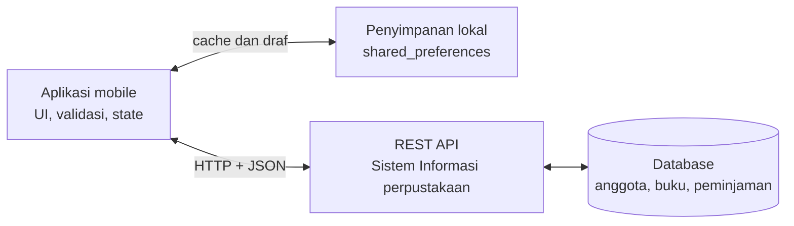

# Referensi Jawaban Tes Konsep UTS (bahan belajar)

Berkas ini bahan belajar untuk menulis versi sendiri, bukan untuk dikumpulkan apa adanya. Tiap jawaban memuat konsep, alasan teknis, dan kaitan dengan kasus. Pada Soal 6 sampai 8 contoh diambil dari SiLapor Kampus (Tugas 6 dan 7) agar kamu bisa menjelaskannya saat wawancara.

## Soal 1: Konsep Aplikasi Bergerak dalam SI

1. **Mobilitas dan ketersediaan di mana saja.**
   Contoh penerapan: mahasiswa mengajukan surat keterangan aktif kuliah dari kos atau di sela pergantian kelas, tanpa datang ke loket dan tanpa antre. Aplikasi web desktop menuntut mahasiswa duduk di depan komputer, padahal alat yang pasti dibawa ke mana-mana adalah ponsel.

2. **Konektivitas terus-menerus dan notifikasi.**
   Contoh penerapan: pemberitahuan "surat siap diambil" muncul di layar kunci, sehingga mahasiswa ke loket sekali saja dan tidak bolak-balik mengecek. Tanpa notifikasi, pengguna harus membuka aplikasi sendiri untuk tahu ada perubahan. Kelemahannya, fitur ini butuh backend dan izin notifikasi, jadi biayanya lebih besar dibanding halaman web biasa.

3. **Akses ke fitur perangkat (kamera, penyimpanan lokal, biometrik).**
   Contoh penerapan: mahasiswa memotret dokumen pendukung, misalnya KTM atau bukti pembayaran, lalu melampirkannya pada pengajuan. Draf formulir bisa disimpan di perangkat bila sinyal hilang, dan login bisa memakai sidik jari. Karena layarnya kecil dan sesi pemakaian singkat, formulir harus dipendekkan, tidak sekadar disalin dari versi web.

Ketiganya punya akar yang sama: masalah di kasus ini muncul saat mahasiswa sedang bergerak dan waktunya sempit, jadi solusi harus ada di tempat dan saat itu.

## Soal 2: Dasar Pemrograman Dart

- `List<String> daftarSurat = []`: variabel penyimpan koleksi berurutan yang hanya boleh berisi `String`. Tipe generik `<String>` membuat kompiler menolak elemen bertipe lain (misalnya angka). `[]` membuat list kosong yang bisa bertambah. Datanya hidup di memori selama program berjalan.
- Parameter `String jenis`: nilai masukan dari pemanggil, bertipe `String`. Dengan parameter, fungsi dapat dipakai untuk jenis surat apa saja tanpa menulis ulang. Karena Dart memakai null safety, `jenis` tidak bisa `null`, sehingga validasi cukup memeriksa apakah ia kosong.
- `jenis.isEmpty`: properti `String` yang bernilai `true` bila panjang teks 0. Di sini dipakai sebagai validasi masukan. Kelemahannya, teks berisi spasi saja lolos; versi yang lebih aman adalah `jenis.trim().isEmpty`.
- `return` pada kondisi error: menghentikan fungsi `tambahSurat` saat itu juga. Baris `daftarSurat.add(jenis)` di bawahnya tidak dijalankan, sehingga data tidak valid tidak pernah masuk ke list. Pola ini disebut guard clause. Tanpa `return`, pesan error tercetak tetapi data kosong tetap ditambahkan.
- `daftarSurat.add(jenis)`: menambahkan elemen ke akhir list, sehingga `length` bertambah satu.
- Perulangan `for`: variabel `i` mulai dari 0 dan naik selama `i < daftarSurat.length`. Tiap putaran membaca `daftarSurat[i]` dan mencetaknya dengan nomor `i + 1`, karena index dimulai dari 0 sedangkan nomor urut untuk manusia dimulai dari 1. Bila kondisinya `<=`, putaran terakhir mengakses index yang tidak ada dan memunculkan `RangeError`.

**Kesalahan umum bila validasi `isEmpty` dihapus:** string kosong masuk ke list dan tampil sebagai baris tanpa isi (misalnya `3. `). Data kotor ini ikut terbawa ke layar, dan pemanggil mengira penambahan berhasil karena tidak ada pesan penolakan.

## Soal 3: Struktur Flutter dan Widget

- `MaterialApp`: akar aplikasi. Menyediakan tema Material, pengelola navigasi (`Navigator`, `routes`), dan menentukan halaman awal lewat `home` atau `initialRoute`.
- `Scaffold`: kerangka satu halaman bergaya Material. Menyediakan slot `appBar`, `body`, dan `floatingActionButton`, serta menjadi tempat `SnackBar` ditampilkan.
- `AppBar`: bilah judul di bagian atas ("Daftar Surat"). Pada halaman yang dibuka lewat push, ia otomatis memunculkan tombol kembali.
- `Column`: menyusun anak-anaknya secara vertikal dari atas ke bawah.
- `Text`: menampilkan teks ("Pilih jenis surat").
- `ListView.builder`: daftar yang dapat digulir dan membangun item sesuai kebutuhan (`itemCount` dan `itemBuilder`). Efisien untuk daftar panjang karena item di luar layar tidak dibangun.

**Masalah bila `ListView.builder` di dalam `Column` tanpa `Expanded`:** aplikasi mengeluarkan error "Vertical viewport was given unbounded height" dan daftar tidak tampil.

**Penyebab:** `Column` memberi anak yang tidak fleksibel tinggi tak terbatas pada sumbu vertikal. `ListView` adalah widget yang menggulir dan berusaha mengambil setinggi mungkin, sehingga ia tidak punya batas tinggi untuk dipakai.

**Perbaikan:** bungkus `ListView.builder` dengan `Expanded` supaya ia mengambil sisa tinggi layar setelah `Text`. Alternatifnya `shrinkWrap: true`, tetapi item jadi dibangun sekaligus dan keunggulan efisiensi `builder` hilang. Perbedaan dengan `RenderFlex overflow`: error itu muncul bila anak yang tidak menggulir lebih tinggi dari ruang yang tersedia, bukan karena tinggi tak terbatas.

## Soal 4: Analisis Kebutuhan dan User Flow

| No. | Permintaan | Fungsional/Nonfungsional | Prioritas MoSCoW | Alasan |
|:---:|:-----------|:-------------------------|:----------------:|:-------|
| 1 | Mengajukan surat keterangan aktif kuliah | Fungsional: sistem menerima dan menyimpan pengajuan | Must | Inti layanan. Tanpa ini aplikasi tidak menggantikan formulir dan antrean di loket |
| 2 | Melihat status pengajuan | Fungsional: sistem menampilkan status terakhir | Must | Masalah utama mahasiswa adalah tidak tahu posisi pengajuannya dan harus bolak-balik ke loket. Pengajuan tanpa status tidak menyelesaikan masalah itu |
| 3 | Menerima notifikasi saat surat siap diambil | Fungsional: sistem mengirim pemberitahuan saat status berubah | Won't (saat ini) | Status tetap bisa dicek manual lewat kebutuhan 2. Notifikasi bergantung pada fitur perangkat dan backend yang baru dipelajari pada paruh akhir semester, jadi ditunda, bukan dibuang |

Ketiga permintaan itu pada dasarnya fungsional karena menyebut perilaku sistem. Kebutuhan nonfungsional tidak muncul eksplisit, tetapi tersirat dan bisa diturunkan dengan ukuran yang bisa diuji:

- Kegunaan (dari permintaan 1): mahasiswa menyelesaikan pengajuan dalam maksimal 6 langkah dari membuka aplikasi, karena ia sedang di sela kuliah atau antre.
- Kinerja (dari permintaan 2): status tampil kurang dari 3 detik pada jaringan kampus.
- Ketepatan waktu (dari permintaan 3): notifikasi diterima kurang dari 1 menit setelah status berubah. Ikut berstatus Won't selama notifikasi ditunda.

**User flow untuk kebutuhan Must (permintaan 1 dan 2):**

1. Mahasiswa membuka aplikasi dan melihat halaman daftar surat beserta status pengajuan sebelumnya.
2. Mahasiswa memilih jenis surat "Surat Keterangan Aktif Kuliah".
3. Aplikasi membuka form pengajuan dengan jenis surat sudah terisi.
4. Mahasiswa mengisi keperluan pengajuan lalu mengetuk Kirim.
5. Aplikasi memeriksa input. Bila ada field kosong, pesan kesalahan muncul pada field tersebut dan alur kembali ke langkah 4.
6. Bila valid, pengajuan tersimpan dengan status Menunggu dan konfirmasi (`SnackBar`) muncul.
7. Aplikasi kembali ke daftar. Mahasiswa melihat pengajuan baru dan dapat membuka detail untuk memantau statusnya.

## Soal 5: UI/UX Mobile

1. **Prinsip: target sentuh dan jangkauan ibu jari.**
   Keputusan desain: tiap baris dan tombol Ajukan berukuran minimal 48 dp dengan jarak antarbaris yang cukup; seluruh baris dapat diketuk untuk membuka detail; aksi utama ditaruh di bagian bawah layar.
   Alasan: ujung jari jauh lebih lebar dari kursor mouse. Dua puluh tombol yang rapat membuat salah tekan, dan bagian atas layar sulit dijangkau satu tangan.

2. **Prinsip: hierarki visual dan keterbacaan di layar kecil.**
   Keputusan desain: nama surat sebagai teks paling menonjol (tebal), keterangan kecil berwarna redup, dan status berbentuk chip yang memakai ikon dan teks, bukan warna saja. Ukuran teks diambil dari tema agar sama di semua halaman.
   Alasan: layar hanya memuat beberapa kartu sekaligus, dan mata harus langsung menemukan "surat apa dan statusnya apa". Ikon menjaga status tetap terbedakan di bawah sinar matahari atau bagi pengguna buta warna.

3. **Prinsip: efisiensi untuk sesi singkat dan daftar panjang.**
   Keputusan desain: kolom pencarian di atas daftar, ringkasan jumlah pengajuan yang menunggu di bagian atas, dan jalur pengajuan yang tidak lebih dari 6 langkah.
   Alasan: dengan 20 jenis surat, menggulir satu per satu memakan waktu yang tidak dimiliki mahasiswa di sela kuliah. Pencarian memotong langkah, dan ringkasan menjawab pertanyaan paling sering ("sudah sampai mana?") tanpa membuka halaman lain.

## Soal 6: Navigasi dan Interaksi

**Metode navigasi dan kapan digunakan:**

- `push`: `Navigator.push(context, MaterialPageRoute(builder: ...))` membuka halaman dengan membuat objek route langsung di tempat tombol berada. Cocok untuk halaman sekali pakai atau percobaan cepat, tetapi pemanggilan tersebar sehingga sulit ditelusuri.
- `pushNamed`: membuka halaman berdasarkan nama yang didaftarkan sekali pada `MaterialApp(initialRoute:, routes:)`. Dipakai untuk tiga halaman utama (`/` daftar, `/form`, `/detail`). Nama disimpan sebagai konstanta (di SiLapor Kampus, kelas `Rute`) agar sama di diagram, peta `routes`, dan pemanggilan, sehingga mudah ditelusuri ke rancangan IA.
- `pop`: kembali ke halaman sebelumnya dengan membuang halaman teratas dari stack. Dipasang pada halaman hasil push (form dan detail), bukan pada halaman pertama karena `pop` di sana menutup aplikasi. `pop` juga dapat membawa hasil: `Navigator.pop(context, hasil)`.

**Pengiriman data jenis surat ke halaman form:** lewat `arguments` saat `pushNamed`:

```dart
Navigator.pushNamed(context, '/form', arguments: jenisSurat);
```

Di halaman form, data dibaca dengan pemeriksaan tipe dan cabang null:

```dart
final args = ModalRoute.of(context)?.settings.arguments;
final jenis = args is String ? args : null;
```

`ModalRoute.of(context)` bisa null dan `arguments` bertipe `Object?`, jadi `as` langsung berisiko error. Bila `jenis` null, form menampilkan pilihan manual atau teks pengganti, bukan berhenti dengan error. Arah data satu arah dan read-only, karena form hanya perlu membaca jenis yang dipilih.

**Feedback setelah form dikirim:** urutannya validasi, feedback, lalu kembali. `_formKey.currentState!.validate()` dipanggil dahulu. Bila ada field tidak valid, pesan validator muncul di bawah field itu dan proses berhenti. Bila valid, `ScaffoldMessenger.of(context).showSnackBar(...)` mengonfirmasi bahwa pengajuan tercatat, lalu `Navigator.pop(context)` mengembalikan pengguna ke daftar. Pesan validator menjelaskan apa yang salah dan di mana, sedangkan `SnackBar` menjelaskan apa yang baru terjadi. Keduanya tidak saling menggantikan. Pada SiLapor Kampus pola yang sama dipakai, dan setelah Tugas 7 laporan baru dikembalikan lewat `Navigator.pop(context, laporan)`.

## Soal 7: Model Data dan State

**Mengapa setiap field bersifat `final`:** objek tidak berubah setelah dibuat. Satu referensi yang dipegang beberapa layar tidak bisa diubah diam-diam oleh salah satunya, sehingga asal sebuah perubahan mudah dilacak. Bila sesuatu perlu berubah (misalnya status), dibuat objek baru dan objek lama diganti pada list. Konstruktor `const` dengan `required` juga memastikan tidak ada objek dengan data tidak lengkap.

**Mengapa `id` wajib ada:** `id` adalah kunci unik untuk menemukan satu pengajuan saat update atau delete. Field lain tidak bisa menjadi kunci: dua pengajuan dengan jenis dan tanggal yang sama sangat mungkin ada. `id` juga tidak berubah ketika posisi data bergeser. Pada aplikasi ini `id` dibuat dari waktu saat ini, dan kelak akan diberikan oleh server.

**Perbedaan `StatelessWidget` dan `StatefulWidget`:** `StatelessWidget` tampilannya sepenuhnya ditentukan oleh nilai yang diberikan lewat konstruktor dan tidak menyimpan data yang berubah. `StatefulWidget` punya objek `State` terpisah yang hidup lebih lama dari widget, menyimpan data yang berubah, dan dapat membangun ulang tampilan lewat `setState`. `State` juga menyediakan siklus hidup seperti `initState` dan `dispose`.

**Halaman daftar menggunakan `StatefulWidget`.** Alasan: `List<PengajuanSurat>` berubah ketika pengajuan ditambah, diubah, atau dihapus, dan tampilan harus mengikuti. Data itu disimpan pada `State` halaman.

**Fungsi `setState`:** memberi tahu Flutter bahwa data pada `State` berubah sehingga widget perlu dibangun ulang dengan data terbaru. Perubahan data dilakukan di dalam callback-nya.

**Bila data ditambah tanpa `setState`:** isi list di memori memang bertambah, tetapi `build` tidak dipanggil ulang sehingga layar tidak berubah. Bug ini membingungkan karena datanya ada. Daftar baru tampak berubah ketika sesuatu yang lain kebetulan memicu pembangunan ulang.

## Soal 8: CRUD Lokal

| Operasi | Method `List` / mekanisme |
|:--------|:--------------------------|
| Create  | `add` (atau `insert(0, x)` agar data baru di paling atas) dengan `id` unik, dari form yang valid, dibungkus `setState` |
| Read    | `ListView.builder` dengan `itemCount: _daftar.length` dan `itemBuilder` yang membaca `_daftar[index]`; pencarian memakai `where(...).toList()` |
| Update  | `indexWhere((p) => p.id == id)` untuk mencari posisi, lalu `_daftar[index] = objekBaru` (objek lama diganti karena field `final`), dibungkus `setState` |
| Delete  | `removeWhere((p) => p.id == id)` setelah konfirmasi `AlertDialog`, dibungkus `setState` |

**Mengapa `id` digunakan sebagai kunci update dan delete:** `id` unik dan tetap, sedangkan index hanyalah posisi sementara. `id` tetap menunjuk data yang sama walaupun daftar berubah urutan atau ditampilkan sebagian.

**Konsekuensi bila index digunakan sebagai kunci:** index bergeser setiap ada penghapusan atau penyisipan. Setelah item pertama dihapus, item yang tadinya di index 2 kini berada di index 1, sehingga operasi yang memakai index lama mengenai data yang salah atau melempar `RangeError` bila index melewati panjang list. Pada daftar hasil pencarian masalahnya lebih nyata: index 0 pada daftar tersaring bukan index 0 pada daftar asli, jadi mengubah atau menghapus "item pertama hasil pencarian" bisa mengenai pengajuan orang lain. Di SiLapor Kampus, karena itulah Update dan Delete memakai `id`.

## Soal 9: Persistensi Data Lokal

**Perbedaan in-memory dan persistensi:** data in-memory hidup di RAM selama proses aplikasi berjalan, sehingga hilang saat aplikasi ditutup atau dimulai ulang. Cepat, sederhana, tanpa package tambahan, dan bisa dijalankan di DartPad. Persistensi dengan `shared_preferences` menulis data ke penyimpanan perangkat (pada web, penyimpanan browser) sehingga bertahan setelah aplikasi ditutup. Penyimpanannya berbentuk pasangan kunci-nilai untuk nilai sederhana, jadi daftar objek diubah dulu menjadi teks JSON dengan `jsonEncode` dan dikembalikan dengan `jsonDecode`. Harganya: ada langkah konversi, operasinya asinkron, dan package ini hanya berjalan di Flutter SDK, tidak di DartPad.

**Mengapa operasi `shared_preferences` asinkron (`Future`):** membaca dan menulis ke penyimpanan perangkat jauh lebih lambat dibanding operasi di memori dan harus lewat lapisan platform. Bila dikerjakan sinkron, thread UI terblokir dan tampilan macet selama menunggu. Dengan `Future`, UI tetap responsif sementara hasilnya ditunggu.

**Bila `await` diabaikan:** kode setelahnya langsung berjalan padahal penulisan belum selesai, sehingga aplikasi bisa mengira data sudah tersimpan. Bila aplikasi ditutup saat itu, data hilang. Bila data dibaca tepat setelahnya, bisa terbaca nilai lama. Kesalahan di dalam `Future` yang tidak ditunggu juga tidak tertangkap. Pada pembacaan, mengabaikan `await` membuat variabel berisi `Future`, bukan teksnya, dan itu memicu error tipe.

**Contoh situasi in-memory sudah cukup:** kata kunci pencarian yang sedang diketik, pilihan filter sementara, isi field form yang belum dikirim, atau prototipe dan demo di DartPad dengan data contoh.

**Contoh situasi persistensi mutlak diperlukan:** laporan atau pengajuan yang dibuat pengguna dan harus bisa dicek lagi besok, seperti mahasiswa yang melihat status pengajuan beberapa kali per minggu. Contoh lain: token login, pengaturan tema, dan draf form panjang. Untuk data yang bernilai sebagai bukti (misalnya status resmi pengajuan), penyimpanan lokal pun belum cukup karena bisa terhapus saat data aplikasi dibersihkan, jadi sumber kebenarannya harus di server.

## Soal 10: Integrasi Konsep Lintas Pertemuan

### 1. Arsitektur

Pola client-server tiga lapis. Aplikasi mobile (Flutter) menangani tampilan, validasi, dan state. Penyimpanan lokal menyimpan cache katalog terakhir dan draf sehingga aplikasi tetap berguna saat sinyal lemah. Backend Sistem Informasi perpustakaan (REST API dan database anggota, buku, serta peminjaman) adalah sumber kebenaran data dan tempat aturan bisnis dijalankan, misalnya pengecekan stok dan batas jumlah pinjaman. Aplikasi tidak mengakses database langsung, demi keamanan dan agar aturan bisnis tidak tersebar di tiap klien.



Pada tahap UTS (Minggu 1 sampai 7) bagian yang dibangun adalah aplikasi dengan data lokal. Koneksi ke backend menyusul pada integrasi REST API.

### 2. Kebutuhan dan alur

Dua kebutuhan Must have:

- F-01: anggota dapat meminjam buku yang tersedia, sehingga peminjaman tercatat dan stok berkurang.
- F-02: anggota dapat melihat riwayat peminjamannya beserta status (Dipinjam atau Dikembalikan), sehingga ia tahu buku mana yang masih dipegang.

Alur pengguna dari membuka aplikasi hingga selesai:

1. Anggota membuka aplikasi dan melihat halaman katalog buku.
2. Anggota mencari judul atau memilih buku yang statusnya tersedia.
3. Anggota mengetuk Pinjam, lalu aplikasi membuka form peminjaman dengan data buku terisi.
4. Anggota mengisi data yang dibutuhkan (misalnya lama pinjam) lalu mengetuk Kirim.
5. Aplikasi memvalidasi. Bila ada field tidak valid, pesan muncul pada field itu dan alur kembali ke langkah 4.
6. Bila valid, peminjaman tercatat, stok buku berkurang, dan `SnackBar` memberi konfirmasi.
7. Aplikasi kembali ke katalog. Anggota membuka halaman riwayat dan melihat peminjaman barunya di paling atas.

### 3. Struktur komponen

```dart
MaterialApp(
  initialRoute: '/',
  routes: {
    '/': (context) => const HalamanKatalog(),
    '/pinjam': (context) => const HalamanFormPinjam(),
    '/riwayat': (context) => const HalamanRiwayat(),
  },
)
```

- `HalamanKatalog` (`StatefulWidget`): `Scaffold` dengan `AppBar` (ikon menuju riwayat), `Column` berisi `TextField` pencarian dan `Expanded(ListView.builder(...))` yang menampilkan `Card` atau `ListTile` per buku beserta tombol Pinjam.
- `HalamanFormPinjam` (`StatefulWidget`, agar controller bisa di-`dispose`): `Scaffold` dengan `Form` ber-`GlobalKey<FormState>`, `TextFormField` yang punya validator, dan `FilledButton` Kirim.
- `HalamanRiwayat`: `Scaffold` dengan `ListView.builder` yang membaca daftar peminjaman.

Navigasi memakai `pushNamed`. Katalog membuka form dengan `Navigator.pushNamed(context, '/pinjam', arguments: buku)`. Form membaca buku dengan pemeriksaan `is Buku` dan cabang null, lalu mengembalikan hasil lewat `Navigator.pop(context, peminjaman)`. Katalog membuka riwayat dengan `pushNamed('/riwayat', arguments: daftarRiwayat)`, dan riwayat hanya membaca. Tombol kembali pada AppBar otomatis ada di dua halaman terakhir.

### 4. Data dan state

```dart
class Buku {
  const Buku({
    required this.id,
    required this.judul,
    required this.penulis,
    required this.kategori,
    required this.stok,
  });

  final String id;
  final String judul;
  final String penulis;
  final String kategori;
  final int stok;
}

class Peminjaman {
  const Peminjaman({
    required this.id,
    required this.idBuku,
    required this.judulBuku,
    required this.tanggalPinjam,
    required this.status,
  });

  final String id;
  final String idBuku;
  final String judulBuku;
  final String tanggalPinjam;
  final String status; // Dipinjam atau Dikembalikan
}
```

`Buku` memiliki lima field. Model kedua, `Peminjaman`, dibutuhkan karena riwayat adalah data tersendiri yang merujuk buku lewat `idBuku`.

State dimiliki satu tempat, yaitu `State` halaman katalog: `List<Buku> _katalog` dan `List<Peminjaman> _riwayat`.

**Create (meminjam):** form yang valid mengembalikan objek `Peminjaman` dengan `id` unik dan status `Dipinjam`. Katalog menerimanya, lalu menambahkannya ke riwayat dan mengurangi stok buku dengan mengganti objek lama berdasarkan `id`, semuanya dalam satu `setState`:

```dart
void _pinjam(Buku buku, Peminjaman baru) {
  setState(() {
    _riwayat.insert(0, baru);
    final index = _katalog.indexWhere((b) => b.id == buku.id);
    if (index != -1) {
      _katalog[index] = Buku(
        id: buku.id,
        judul: buku.judul,
        penulis: buku.penulis,
        kategori: buku.kategori,
        stok: buku.stok - 1,
      );
    }
  });
}
```

Tombol Pinjam dinonaktifkan bila `stok` sudah 0, agar stok tidak bernilai negatif.

**Read (melihat riwayat):** `HalamanRiwayat` menerima `_riwayat` lewat `arguments` (read-only) dan menampilkannya dengan `ListView.builder` (`itemCount: riwayat.length`, `itemBuilder` membaca `riwayat[index]`). Setiap kali riwayat berubah, `setState` pada katalog membangun ulang tampilan, dan kunjungan berikutnya ke halaman riwayat memuat data terbaru. Ketiga poin di atas konsisten: arsitektur menempatkan aturan stok di server, alur memakai dua kebutuhan Must tadi, komponen memetakan keduanya ke dua halaman, dan state menjadi satu-satunya tempat data berubah.
