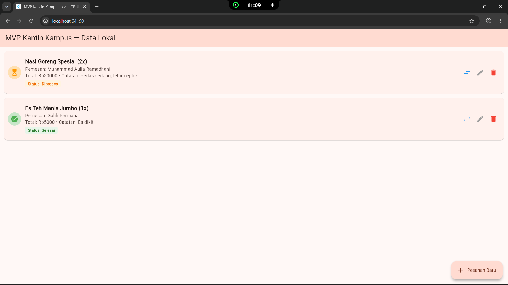
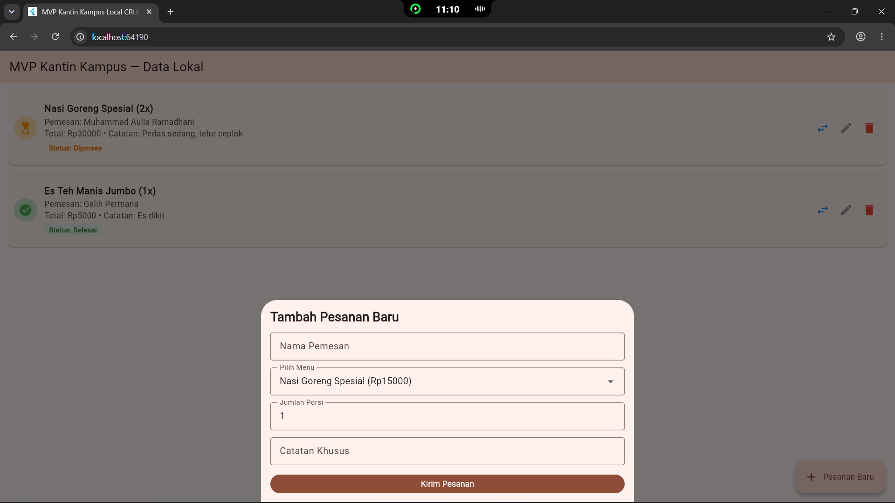
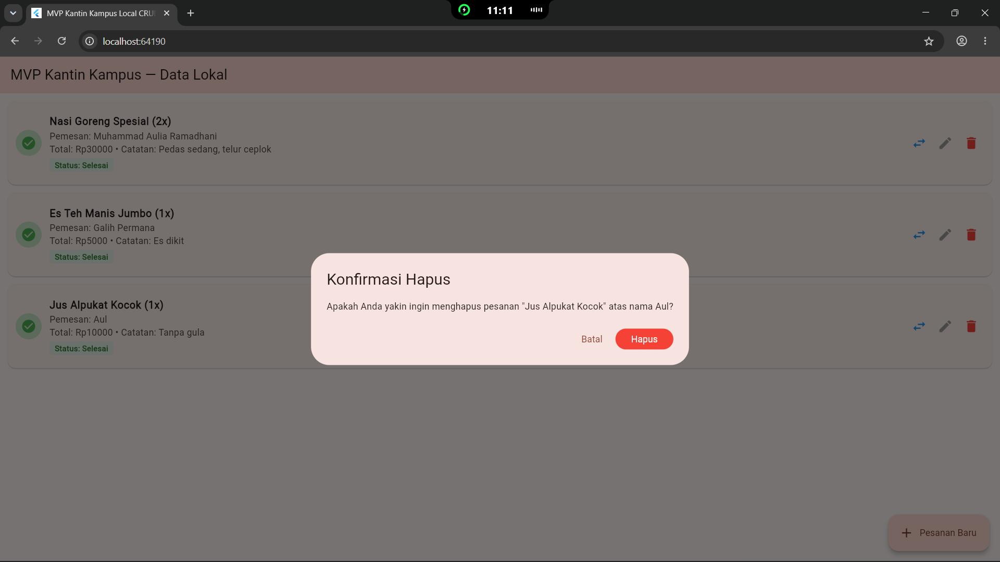

# Laporan Progress Project UTS (Milestone M4)

| | |
|:--|:--|
| **Nama** | Muhammad Aulia Ramadhani |
| **NIM** | 230660221013 |
| **Kelas** | SI-VIIA-Mobile |
| **Domain SI** | Pemesanan Kantin Kampus |
| **Judul Aplikasi** | KantinApp MVP |
| **Tautan Repository** | [Isi dengan Tautan Folder Tugas 8 GitHub kamu] |

---

## 1. Ringkasan Eksekutif Project
Aplikasi Pemesanan Kantin Kampus hadir untuk memecahkan masalah antrean panjang saat jam istirahat mahasiswa. Penggunanya adalah mahasiswa yang ingin memesan hidangan dari meja kantin atau ruang kelas secara *remote*.

Solusi mobile ini dipilih karena memberikan akses instan dari ponsel (*mobile accessibility*), interaksi layar sentuh yang responsif, dan kapabilitas State reaktif (*Flutter*) yang mengefisienkan proses CRUD sehingga mahasiswa dan pengelola kantin bisa mengecek status pesanan kapan saja tanpa ribet.

## 2. Ketercapaian Milestone (M1 s.d. M3)

| Milestone | Deliverable | Status (Selesai / Sebagian) | Catatan / Bukti |
|:----------|:------------|:----------------------------|:----------------|
| M1: Kebutuhan | Dokumen kebutuhan + User Flow | Selesai | File `kebutuhan.md` di Tugas 4 |
| M2: UI/UX | Wireframe + Navigasi | Selesai | File prototype & navigasi di Tugas 5 & 6 |
| M3: MVP Awal | Model data + CRUD lokal | Selesai | File `crud-lokal.dart` di Tugas 7 |

## 3. Matriks Kebutuhan ke Implementasi

| ID Kebutuhan | Deskripsi Kebutuhan | Prioritas MoSCoW | Halaman Pemenuh | Operasi Data Terkait |
|:-------------|:-------------------|:----------------:|:----------------|:---------------------|
| F-01 | Melihat ringkasan menu dan harga | Must | Modal Form Menu | Read |
| F-02 | Mengajukan/menambah pesanan baru | Must | Modal Form & Utama | Create |
| F-03 | Menampilkan riwayat daftar pesanan | Must | Halaman Utama | Read |
| F-04 | Mengubah porsi pesanan atau status proses | Should | Halaman Utama (Update) | Update |
| F-05 | Membatalkan / Menghapus pesanan | Could | Dialog Konfirmasi | Delete |

## 4. Tangkapan Layar Aplikasi Berjalan
*(Ganti nama file gambar di bawah ini dengan *path* gambar yang sesuai pada GitHub)*

1. **Halaman utama / daftar data:**
   
2. **Halaman form pengisian data dengan validasi:**
   
3. **Dialog konfirmasi aksi (hapus):**
   

## 5. Kendala dan Solusi Teknis

| No. | Kendala | Cara Mengatasinya |
|:---:|:--------|:------------------|
| 1 | Widget `ListView.builder` sempat error memicu peringatan "*Unbounded Height*" saat dirancang di dalam Column. | Membungkus `ListView.builder` menggunakan widget `Expanded` agar list menempati sisa *height* yang spesifik. |
| 2 | Kesulitan saat mengupdate spesifik item pada saat pengubahan data (*Edit* form) karena list hanya mengenali urutan. | Menerapkan `final String id` bertipe timestamp untuk memastikan pencarian index dengan fungsi `indexWhere` selalu menunjuk pada item yang presisi. |

## 6. Rencana Pengembangan Milestone M5 (REST API)
Pada pertemuan ke-9, aplikasi akan mengambil master data "Katalog Menu Kantin" menggunakan pemanggilan GET dari layanan backend (REST API server), sehingga harga satuan bersifat real-time dari database. Selain itu, fungsi `add` pada Create pengajuan akan dimodifikasi dengan metode HTTP POST agar data pesanan persisten tersimpan di database *Cloud*.

## 7. Refleksi Pembelajaran Tengah Semester
Memahami arsitektur layout Flutter sangat krusial, utamanya pada relasi *Parent-Child* di dalam struktur komponen. Dalam mengelola state, kedisiplinan *State Management* seperti menempatkan perubahan di dalam `setState` sangat menantang namun melatih pola pikir reaktif. Membangun aplikasi mobile bukan hanya soal desain cantik, namun menjaga agar logika CRUD lokal sinkron secara presisi dengan kebutuhan bisnis di antarmuka.

## 8. Deklarasi Penggunaan AI
Deklarasi penggunaan AI: ChatGPT — membantu memberikan kerangka dasar manajemen metode `List` pada operasi CRUD serta contoh sintaks dasar; penyesuaian kode dan perumusan teks dilakukan serta diverifikasi oleh penulis.