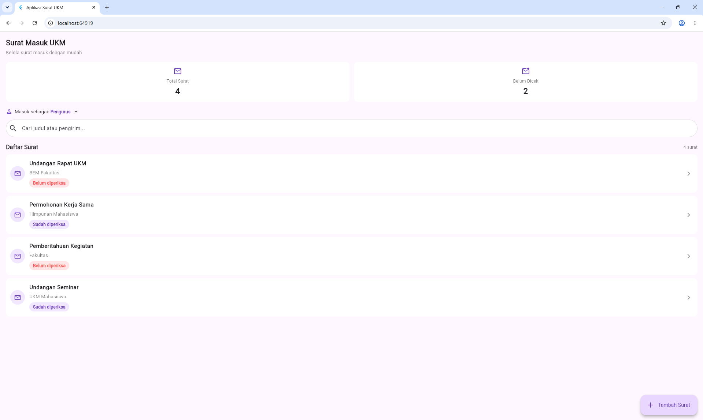
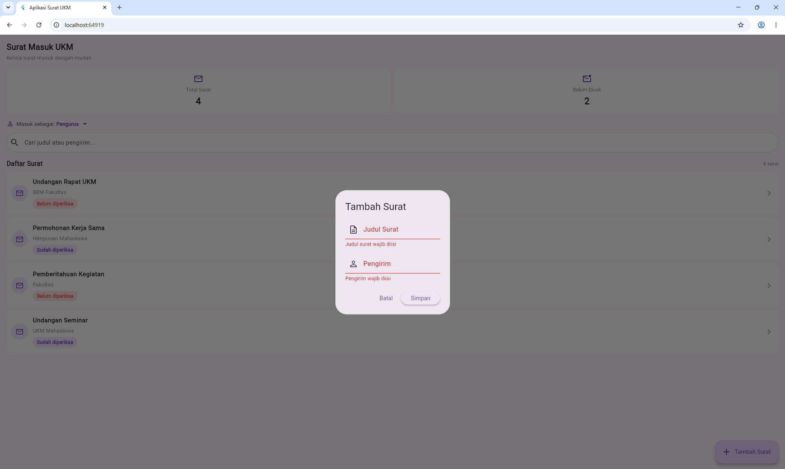
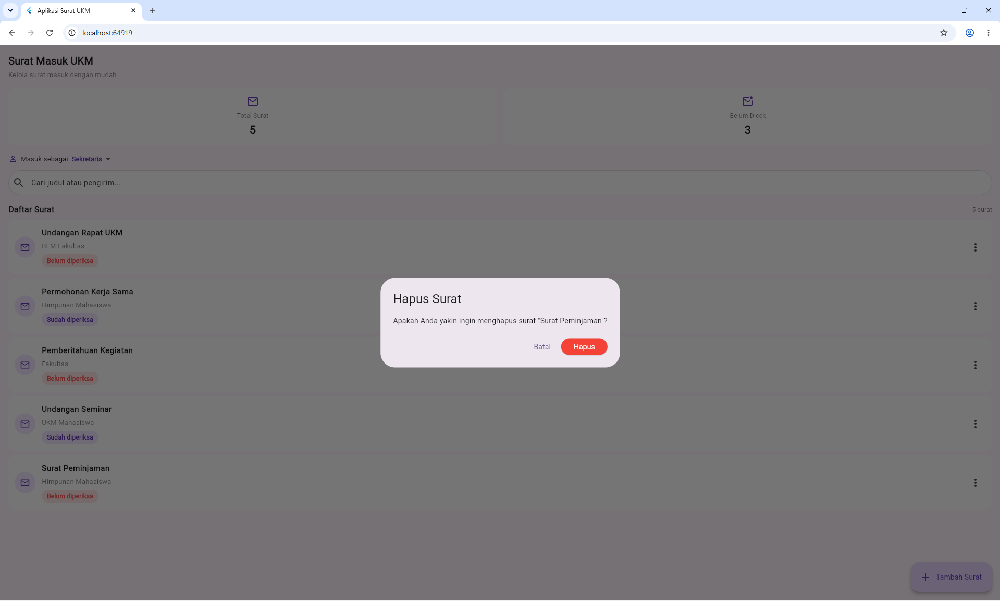

# Laporan Progress UTS

## 2.1 Tabel Identitas

| | |
|---|---|
| Nama | Lala Jalaliah |
| NIM | 230660221019 |
| Kelas | SI-VIIA |
| Domain SI | Pengelolaan Surat Masuk UKM |
| Judul Aplikasi | Aplikasi Pengelolaan Surat Masuk UKM |
| Tautan Repository | [SI-VIIA-Mobile](https://github.com/lalajalaliah/SI-VIIA-Mobile) |

## 2.2 Ringkasan Eksekutif Project

Aplikasi Pengelolaan Surat Masuk UKM dibuat untuk membantu mengatasi masalah pencatatan surat masuk yang belum teratur. Surat dapat diterima oleh anggota yang berbeda dan sering kali hanya dibagikan melalui grup WhatsApp, sehingga sulit dicatat dan ditemukan kembali. Pengguna aplikasi adalah anggota atau pengurus UKM yang mencatat surat, serta sekretaris UKM yang dapat melihat, mencari, memeriksa, dan memperbarui status surat.

Solusi mobile dipilih karena surat dapat diterima anggota di berbagai tempat dan pencatatan perlu dilakukan dengan cepat melalui smartphone yang digunakan sehari-hari. Selain itu, penggunaan smartphone memungkinkan pengembangan fitur dokumentasi surat fisik menggunakan kamera pada tahap berikutnya.

## 2.3 Ketercapaian Milestone (M1 s.d. M3)

| Milestone | Deliverable | Status | Catatan / Bukti |
|---|---|---|---|
| M1: Kebutuhan | Dokumen kebutuhan dan User Flow | Selesai | Tugas 4 berisi 8 kebutuhan fungsional, 3 kebutuhan nonfungsional, prioritas MoSCoW, pemetaan kebutuhan ke antarmuka, user flow "Memeriksa surat masuk", dan README. Path: `tugas-4/230660221019-Lala Jalaliah/` |
| M2: UI/UX | Wireframe dan Navigasi | Selesai | Tugas 5 berisi `wireframe.png`, `information-architecture.md`, `catatan-keputusan-ui.md`, `halaman-utama.dart`, dan `screenshot-halaman.png`. Tugas 6 berisi `navigation-flow.md`, `catatan-keputusan-navigasi.md`, `form-interaksi.dart`, `screenshot-alur.png`, dan `screenshot-feedback.png`. Path: `tugas-5/230660221019- Lala Jalaliah/` dan `tugas-6/230660221019- Lala Jalaliah/` |
| M3: MVP Awal | Model data dan CRUD lokal | Selesai | Tugas 7 mengimplementasikan model `SuratMasuk` dengan atribut `id`, `judul`, `pengirim`, dan `status`. Pengelolaan data menggunakan `List<SuratMasuk>` dan `setState()`, dilengkapi fitur tambah, lihat, edit, dan hapus dengan dialog konfirmasi. Path: `tugas-7/230660221019-Lala Jalaliah/` |

Catatan: Status surat pada Tugas 7 terdiri dari dua pilihan, yaitu `Belum diperiksa` dan `Sudah diperiksa`. Status dapat diubah oleh Sekretaris melalui fitur Edit Surat.

## 2.4 Matriks Kebutuhan ke Implementasi

| ID Kebutuhan | Deskripsi Kebutuhan | Prioritas MoSCoW | Halaman Pemenuh | Operasi Data Terkait |
|---|---|---|---|---|
| F-01 | Mencatat informasi surat masuk | Must | Dialog Tambah Surat | Create |
| F-03 | Melihat daftar surat masuk | Must | Halaman Daftar Surat | Read |
| F-04 | Melihat detail surat | Must | Dialog Detail Surat | Read |
| F-06 | Menandai surat sudah diperiksa | Must | Dialog Edit Surat oleh Sekretaris | Update |

Catatan: Operasi Delete merupakan fitur tambahan untuk pengelolaan data. Sebelum surat dihapus, aplikasi menampilkan dialog konfirmasi agar pengguna dapat membatalkan atau melanjutkan penghapusan.

## 2.5 Tangkapan Layar Aplikasi Berjalan

### 1. Halaman Daftar Surat

### 2. Form Tambah Surat

### 3. Konfirmasi Hapus Surat

Catatan: Ketiga file screenshot telah disiapkan dan dimasukkan ke dalam folder Tugas 8 sebagai bukti tampilan aplikasi.

## 2.6 Kendala dan Solusi Teknis

| No. | Kendala | Cara Mengatasinya |
|---|---|---|
| 1 | `ListView` di dalam `Column` pada halaman utama menimbulkan masalah ukuran pada Tugas 3. | Membungkus `ListView` dengan widget `Expanded` agar dapat menggunakan sisa ruang yang tersedia pada halaman. |
| 2 | Rancangan wireframe, kode Flutter, dan catatan keputusan UI belum sepenuhnya selaras pada Tugas 5. | Saya memeriksa kembali susunan komponen pada wireframe dan menyesuaikan tampilan kode Flutter, seperti bagian judul, kartu ringkasan, kolom pencarian, daftar surat, dan informasi status. Setelah itu, saya membandingkan hasil tampilan aplikasi dengan rancangan dan catatan keputusan UI. |

## 2.7 Rencana Pengembangan Milestone M5 (REST API)

Saat ini data surat masih disimpan secara lokal di dalam aplikasi menggunakan `List<SuratMasuk>` sehingga perubahan data tidak tersimpan secara permanen ketika aplikasi dijalankan ulang. Pada Minggu 9–10, aplikasi direncanakan menggunakan REST API agar data dapat disimpan dan diakses melalui server.

Pengembangan selanjutnya mencakup pengambilan daftar surat masuk, detail surat, hasil pencarian surat, serta pembaruan status pemeriksaan melalui API. Aplikasi juga direncanakan dapat mengirim data surat baru beserta file atau foto surat.

Layanan backend yang dibutuhkan meliputi endpoint REST (GET, POST, PUT, dan DELETE), database terpusat, penyimpanan file atau foto surat, pembuatan ID oleh backend, serta autentikasi pengguna untuk membedakan hak akses Pengurus dan Sekretaris.

## 2.8 Refleksi Pembelajaran Tengah Semester

Selama pembelajaran tengah semester, saya memahami bahwa Flutter menyusun tampilan aplikasi menggunakan widget tree, sehingga setiap bagian halaman dibangun dari widget yang saling berkaitan. Saya juga mulai memahami perbedaan `StatelessWidget` dan `StatefulWidget`, terutama penggunaan `setState()` untuk memperbarui tampilan ketika data berubah. Perkembangan dari Tugas 6 ke Tugas 7 membantu saya memahami bahwa data yang dimasukkan melalui form perlu dikelola agar dapat ditampilkan pada daftar surat. Tantangan terbesar bagi saya adalah menjaga agar kebutuhan aplikasi, rancangan tampilan, model data, dan kode program tetap saling sesuai.

## 2.9 Deklarasi Penggunaan AI

Deklarasi penggunaan AI: ChatGPT digunakan untuk membantu menyusun alternatif rumusan kebutuhan dan user flow pada Tugas 4, memberikan contoh kode Flutter serta membantu menyusun catatan keputusan UI dan README pada Tugas 5, serta membantu memahami kode dan menyusun dokumentasi pada Tugas 7. Claude digunakan untuk membantu menjelaskan konsep dan menyusun kerangka laporan progress. Seluruh perubahan kode, pengujian, dan hasil akhir diperiksa serta diverifikasi kembali oleh penulis.