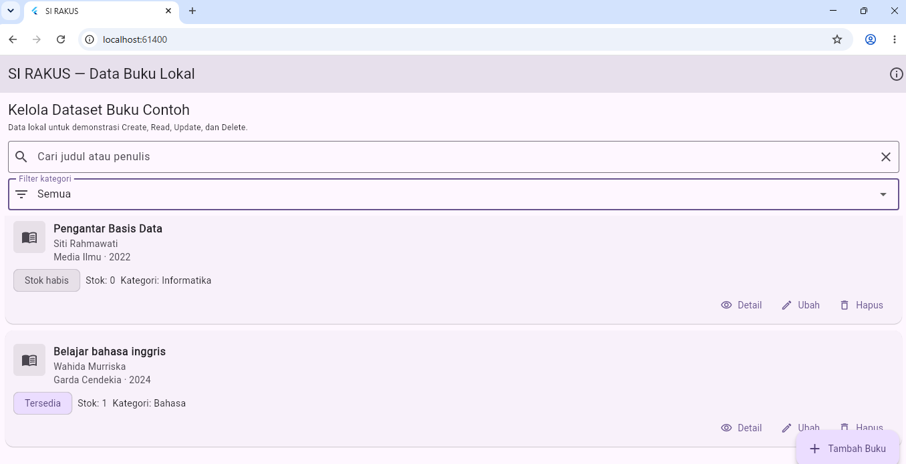
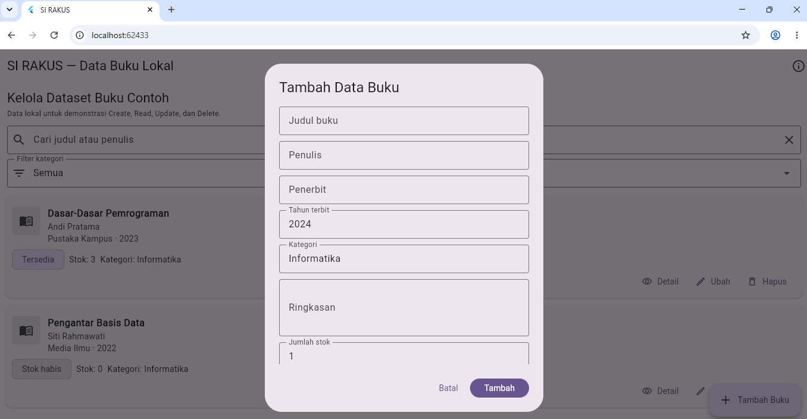
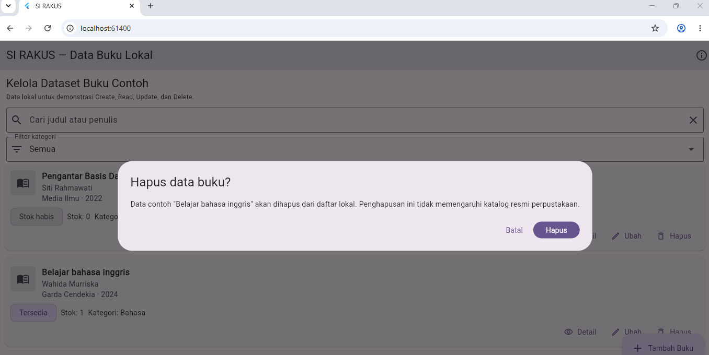

# Laporan Progress Project UTS (Milestone M4)

| | |
|:--|:--|
| **Nama** | Wendi Feriyanda |
| **NIM** | 230660221026 |
| **Kelas** | SI-VIIA |
| **Domain SI** | Sistem Informasi Perpustakaan Kampus |
| **Judul Aplikasi** | SI RAKUS (Sistem Rak Kampus) |
| **Tautan Repository** | https://github.com/PBWFEND/SI-VIIA-Mobile/tree/230660221026/tugas-8 |

---

## 1. Ringkasan Eksekutif Project

SI RAKUS (Sistem Rak Kampus) adalah aplikasi mobile pada domain perpustakaan kampus yang menyelesaikan masalah sulitnya mahasiswa mengetahui apakah sebuah buku ada dan tersedia sebelum datang ke perpustakaan. Pengguna utamanya adalah mahasiswa yang membutuhkan referensi kuliah. Melalui aplikasi ini, mahasiswa dapat melihat katalog, mencari buku berdasarkan judul atau penulis, menyaring berdasarkan kategori, serta melihat detail dan status stok buku.

Solusi mobile dipilih karena ponsel selalu dibawa mahasiswa sehingga informasi koleksi dapat dicek dari kampus maupun dari luar kampus, dan interaksi sentuh cocok untuk pencarian informasi dalam sesi singkat. SI RAKUS diposisikan sebagai rancangan antarmuka mobile yang berorientasi pada mahasiswa, bukan pengganti sistem perpustakaan yang sudah ada (Libsys). Pada tahap ini data masih berupa data contoh yang disimpan secara lokal (in-memory), sehingga prototype belum terhubung dengan katalog resmi maupun akun perpustakaan.

## 2. Ketercapaian Milestone (M1 s.d. M3)

| Milestone | Deliverable | Status (Selesai / Sebagian) | Catatan / Bukti |
|:----------|:------------|:----------------------------|:----------------|
| M1: Kebutuhan | Dokumen kebutuhan + User Flow | Selesai | File `dokumen-kebutuhan.md` dan `user-flow.png` (Tugas 4): dua persona, 9 kebutuhan fungsional, 3 nonfungsional, prioritas MoSCoW, dan user flow. |
| M2: UI/UX | Wireframe + Navigasi | Selesai | Wireframe, `information-architecture.md`, dan catatan keputusan UI/UX (Tugas 5); `navigation-flow.md` dengan form validasi dan feedback SnackBar (Tugas 6). |
| M3: MVP Awal | Model data + CRUD lokal | Selesai | File `crud-lokal.dart` dan `model-data.md` (Tugas 7): model `DataBuku`, `List<DataBuku>` pada state, operasi Create, Read, Update, Delete dengan `id` sebagai kunci. Bukti pada bagian 4. |

## 3. Matriks Kebutuhan ke Implementasi

| ID Kebutuhan | Deskripsi Kebutuhan | Prioritas MoSCoW | Halaman Pemenuh | Operasi Data Terkait |
|:-------------|:-------------------|:----------------:|:----------------|:---------------------|
| F-01 | Melihat daftar buku dalam katalog | Must | Katalog Buku | Read |
| F-02 | Mencari buku berdasarkan judul atau kata kunci | Must | Katalog Buku | Read (filter) |
| F-03 | Melihat detail buku yang dipilih | Must | Detail Buku | Read |
| F-04 | Melihat stok atau status ketersediaan | Must | Katalog Buku dan Detail Buku | Read (status dihitung dari `stok`) |
| F-05 | Melihat peminjaman aktif milik sendiri | Should | Peminjaman Saya | Read (belum terhubung ke data akun) |
| F-06 | Melihat riwayat peminjaman sendiri | Should | Riwayat Peminjaman | Read (belum terhubung ke data akun) |
| F-08 | Menyaring buku berdasarkan kategori | Could | Katalog Buku | Read (filter) |
| F-09 | Masuk dengan akun perpustakaan yang valid | Should | Masuk/Verifikasi Akun | Validasi form lokal (belum ada autentikasi nyata) |
| F-07 | Petugas memperbarui data koleksi | Won't (saat ini) | Di luar aplikasi mobile mahasiswa | Tidak diimplementasikan |

**Catatan CRUD:** Create, Update, dan Delete pada Tugas 7 hanya mengelola dataset contoh lokal untuk latihan CRUD (menambah buku contoh, mengubah stok, menghapus dengan konfirmasi). Operasi tersebut bukan wewenang mahasiswa terhadap katalog resmi dan tidak sama dengan F-07. Karena penyimpanan in-memory, data kembali ke data awal saat aplikasi dijalankan ulang.

## 4. Tangkapan Layar Aplikasi Berjalan

**4.1 Halaman daftar berisi data**

**4.2 Form pengisian data dengan validasi**

**4.3 Dialog konfirmasi hapus**

## 5. Kendala dan Solusi Teknis

| No. | Kendala | Cara Mengatasinya |
|:---:|:--------|:------------------|
| 1 | `git push` ditolak dengan pesan `Invalid username or token` karena kredensial HTTPS GitHub tidak diterima. | Memeriksa bahwa remote mengarah ke repository kelas yang benar, menghapus kredensial GitHub lama di Windows Credential Manager, lalu masuk ulang dengan akun atau token yang memiliki izin. |
| 2 | Pada kode CRUD, Update dan Delete sempat hanya berisi komentar TODO dan pesan SnackBar sementara, sehingga data belum benar-benar berubah. | Update diperbaiki dengan `indexWhere` berdasarkan `id` lalu mengganti objek di dalam `setState`. Delete menampilkan `AlertDialog` dan, setelah konfirmasi, memakai `removeWhere` berdasarkan `id` di dalam `setState`. Keduanya diuji ulang pada aplikasi yang berjalan. |
| 3 | File Dart yang dibuka di luar root proyek Flutter menampilkan error import `package:flutter/material.dart`. | Menjalankan kode dari proyek Flutter yang memiliki `pubspec.yaml` (kode disalin ke `lib/main.dart`), lalu menjalankan `flutter pub get`, `flutter analyze`, dan `flutter run -d chrome`. |

## 6. Rencana Pengembangan Milestone M5 (REST API)

Data contoh lokal direncanakan diganti dengan data dari layanan backend yang aksesnya diizinkan. Data buku yang akan diambil meliputi ID, judul, penulis, penerbit, tahun terbit, kategori, ringkasan, dan jumlah stok. Aplikasi juga membutuhkan autentikasi sebelum menampilkan peminjaman aktif dan riwayat milik mahasiswa.

Langkah awalnya: (1) menanyakan ketersediaan API dan format datanya kepada pengelola sistem perpustakaan; (2) mengambil katalog dan detail buku dari backend; (3) menangani status loading, data kosong, dan error jaringan; (4) menghubungkan autentikasi dan data peminjaman bila layanannya disediakan. Endpoint seperti `GET /books`, `GET /books/{id}`, `POST /auth/login`, `GET /me/loans`, dan `GET /me/loan-history` hanya contoh rancangan sementara, bukan endpoint yang sudah tersedia atau diuji.

## 7. Refleksi Pembelajaran Tengah Semester

Tantangan terbesar saya adalah menjaga agar kebutuhan pada Tugas 4 tetap konsisten dengan rancangan layar, navigasi, dan pengelolaan data pada tugas berikutnya. Saya memahami bahwa pada arsitektur Flutter, halaman disusun dari widget tree, dan `StatefulWidget` dengan `setState` diperlukan agar perubahan data pada daftar langsung tampil. ID unik memastikan operasi ubah dan hapus mengenai data yang tepat, bukan data lain ketika urutan daftar berubah. Saya juga menyadari bahwa CRUD in-memory hanya bertahan selama aplikasi berjalan, sehingga pada tahap berikutnya saya perlu mempelajari persistensi dan integrasi REST API.

Deklarasi penggunaan AI: ChatGPT — membantu meninjau konsistensi dokumen kebutuhan, IA, navigation flow, model data, serta menjelaskan dan memeriksa struktur kode Flutter/CRUD; Claude — membantu merapikan susunan dan kelengkapan laporan progress, README, dan kerangka file tes konsep; perbaikan kode, pengujian, dan penjelasan dilakukan serta diverifikasi oleh penulis. AI tidak digunakan untuk menjawab Tes Konsep UTS.
