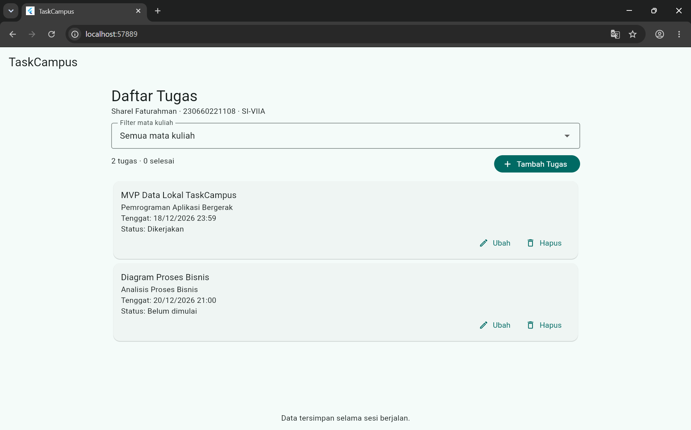
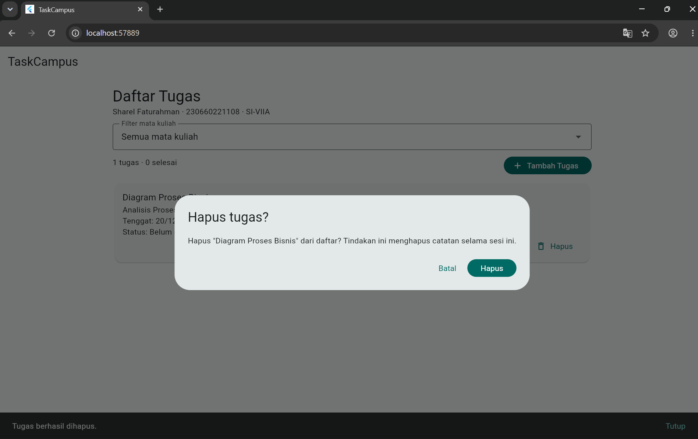

# Laporan Progress UTS — TaskCampus

## 2.1 Tabel Identitas

| Aspek | Isi |
|---|---|
| Nama | Sharel Faturahman |
| NIM | 230660221108 |
| Kelas | SI-VIIA |
| Domain SI | Pengelolaan tugas akademik mahasiswa |
| Judul Aplikasi | TaskCampus |
| Tautan Repository | [Target folder pengumpulan](https://github.com/SharelFatur/SI-VIIA-Mobile/tree/main/tugas-8/230660221108-SharelFaturahman) — berdasarkan konfigurasi origin lokal; berkas UTS belum di-push pada pengerjaan ini. |

## 2.2 Ringkasan Eksekutif Project

TaskCampus membantu mahasiswa mencatat tugas dari berbagai mata kuliah, memantau tenggat, dan memperbarui progres melalui satu aplikasi. Informasi yang sebelumnya tersebar pada percakapan kelas dan catatan pribadi disatukan menjadi daftar yang dapat disaring menurut mata kuliah. Mahasiswa menjadi pengguna utama, sedangkan koordinator informasi kelas merupakan peran rancangan untuk pengembangan berikutnya. Solusi mobile dipilih karena ponsel dibawa saat berpindah kelas dan sesuai untuk pemeriksaan tugas dalam sesi singkat.

MVP saat ini menyediakan tambah, baca, ubah, dan hapus catatan tugas menggunakan data dalam memori. Model Tugas memiliki ID stabil, judul, mata kuliah, tenggat, dan status. Data kembali ke dua catatan awal setelah halaman dimuat ulang; pengingat perangkat, informasi kelas bersama, serta integrasi backend belum diimplementasikan. Laporan ini merangkum artefak yang tersedia, bukan menyatakan seluruh fitur rancangan sudah selesai.

## 2.3 Ketercapaian Milestone (M1 s.d. M3)

| Milestone | Deliverable | Status (Selesai / Sebagian) | Catatan / Bukti |
|---|---|---|---|
| M1: Kebutuhan | Dokumen kebutuhan + User Flow | Sebagian | [Dokumen kebutuhan](../../tugas-4/230660221108-SharelFaturahman/dokumen-kebutuhan.md) dan [user flow](../../tugas-4/230660221108-SharelFaturahman/user-flow.png) tersedia; dua persona dan 10 kebutuhan dipetakan. Penelusuran alur oleh teman sekelas masih tercatat belum dilakukan. |
| M2: UI/UX | Wireframe + Navigasi | Selesai | [Wireframe](../../tugas-5/tugas-5/230660221108-SharelFaturahman/wireframe.png), [IA](../../tugas-5/tugas-5/230660221108-SharelFaturahman/information-architecture.md), dan [navigation flow](../../tugas-6/tugas-6/230660221108-SharelFaturahman/navigation-flow.md) tersedia. Tugas 6 menghubungkan daftar, detail, dan form; perbaikan navigasi serta feedback telah diuji. Status ini merujuk artefak dan alur Tugas 5–6, bukan berarti semua layar IA telah dibuat. |
| M3: MVP Awal | Model data + CRUD lokal | Sebagian | [Model data](../../tugas-7/230660221108-SharelFaturahman/model-data.md) dan [kode CRUD](../../tugas-7/230660221108-SharelFaturahman/crud-lokal.dart) tersedia. Pengujian CRUD dan build web telah berhasil pada pengerjaan Tugas 7; bukti visual Create perlu diperbarui karena screenshot daftar masih memuat data awal, dan screenshot form UTS belum diisi. |

MVP Tugas 7 menggabungkan input tambah dan ubah dalam dialog di atas daftar. Navigasi tiga route pada Tugas 6 tetap menjadi artefak terpisah; laporan tidak menyatakan ketiga route tersebut dipakai oleh MVP dialog saat ini. Demonstrasi UTS kepada dosen belum dilakukan dalam pengerjaan ini.

## 2.4 Matriks Kebutuhan ke Implementasi

| ID Kebutuhan | Deskripsi Kebutuhan | Prioritas MoSCoW | Halaman Pemenuh | Operasi Data Terkait | Status implementasi |
|---|---|---|---|---|---|
| F-01 | Melihat judul, mata kuliah, tenggat, status tugas pribadi | Must | Daftar Tugas | Read melalui ListView.builder | Tersedia pada MVP Tugas 7. |
| F-02 | Menambahkan tugas valid dan unik, status awal Belum dimulai | Must | Dialog Tambah Tugas | Create pada List di State | Tersedia; validator dan pemeriksaan duplikat dijalankan sebelum penambahan. |
| F-03 | Mengubah status tugas | Must | Dialog Ubah Tugas | Update, indexWhere berdasarkan ID | Tersedia; objek baru mempertahankan ID lama. |
| F-04 | Menyaring tugas berdasarkan mata kuliah | Must | Filter pada Daftar Tugas | Read, hasil where atas State | Tersedia; filter tidak mengubah data asli. |
| F-05 | Memperbarui tenggat pribadi | Must | Dialog Ubah Tugas | Update objek menurut ID | Tersedia; tanggal/jam valid dan aturan duplikat tetap diperiksa. |
| F-06 | Menetapkan waktu pengingat | Should | Rencana Pengingat Tugas | Rencana Update pengaturan pengingat | Belum diimplementasikan. |
| F-07 | Koordinator menerbitkan informasi tugas kelas | Should | Rencana Form dan Daftar Informasi Kelas | Rencana Create/Read | Belum diimplementasikan. |
| F-08 | Koordinator memperbarui tenggat informasi miliknya | Should | Rencana Ubah Tenggat Informasi | Rencana Update dengan pembatasan pemilik | Belum diimplementasikan. |
| F-09 | Ringkasan total, aktif, dan selesai | Could | Bagian ringkasan Daftar Tugas | Read dan perhitungan dari State | Sebagian: MVP menampilkan jumlah hasil filter serta jumlah selesai seluruh daftar; jumlah aktif dan total global sebagai ringkasan lengkap belum tersedia. |
| F-10 | Ekspor tugas ke kalender eksternal | Won't | Rencana Ekspor Kalender | Rencana Read untuk ekspor | Ditunda sesuai MoSCoW; belum diimplementasikan. |

Delete memakai removeWhere berdasarkan ID setelah persetujuan AlertDialog. Penghapusan dan koreksi judul/mata kuliah merupakan perluasan pemeliharaan data pada Tugas 7, bukan kebutuhan dengan ID F baru yang sudah ada di Tugas 4. Kriteria nonfungsional seperti uji kegunaan lima mahasiswa dan kinerja 100 tugas masih berupa target; belum ada hasil pengukuran yang disertakan.

## 2.5 Tangkapan Layar Aplikasi Berjalan

| No. | File | Mengisi Bukti | Kondisi saat laporan disusun |
|---|---|---|---|
| 1 | screenshot-daftar.png | Halaman utama / daftar data | Disalin tanpa edit dari Tugas 7. Tampak dua data awal; belum membuktikan hasil Create baru. Ambil ulang setelah menambah tugas. |
| 2 | screenshot-form.png | Form pengisian data dengan validasi | PNG putih kosong untuk diganti sendiri; belum menjadi bukti eksekusi. |
| 3 | screenshot-hapus.png | Dialog konfirmasi hapus | Disalin tanpa edit dari Tugas 7; dialog Hapus tugas? terlihat. |

Screenshot form belum ditampilkan karena berkasnya masih kosong. Untuk mengisinya, buka Tambah Tugas dan tekan Simpan dengan isian kosong agar validator terlihat, lalu ambil seluruh jendela Chrome.

Tidak ada screenshot baru yang diambil otomatis untuk UTS. Ketiga bukti perlu diperiksa penulis sebelum pengumpulan.

## 2.6 Kendala dan Solusi Teknis

| No. | Kendala | Cara Mengatasinya |
|---|---|---|
| 1 | Pada Tugas 6, pemanggilan named route dengan hasil spesifik memicu kesalahan tipe MaterialPageRoute sehingga tombol Tambah tidak membuka form. | Hasil pushNamed diterima sebagai Object? dan diperiksa dengan is Tugas/is StatusTugas sebelum dipakai. Pengujian interaksi dan pemeriksaan langsung Chrome memastikan form serta feedback bekerja. |
| 2 | Peluncur CMD kosong dan lib/main.dart tidak tersedia ketika berkas aktif berganti menjadi main-tugas-6.dart. | Peluncur dipulihkan dan main.dart menjadi pintu masuk yang mengimpor berkas aktif; untuk MVP saat ini diarahkan ke main-tugas-7.dart. |
| 3 | Identitas tugas dapat keliru bila operasi memakai posisi daftar yang berubah saat difilter. | Tugas 7 menggunakan ID unik per sesi; Update mencari ID lewat indexWhere dan Delete memakai removeWhere dengan ID, disertai konfirmasi. |
| 4 | SnackBar dengan aksi Tutup pada Flutter yang dipakai dapat tetap tampil meskipun duration ditentukan. | persist: false ditetapkan bersama durasi 15 detik; pengujian Tugas 6 memeriksa pesan masih terlihat pada 14 detik dan sudah hilang setelah 16 detik. |

Pengujian yang disebutkan dilakukan oleh agen saat pengerjaan proyek sebelumnya; laporan tidak menganggapnya sebagai pengujian mandiri penulis atau peer review. Pada Tugas 7, dua pengujian otomatis lulus: alur tambah–ubah–batal/konfirmasi hapus, serta validasi tanggal; build web juga berhasil. Penulis tetap perlu mengulang demonstrasi pada perangkat yang akan dipakai saat UTS.

## 2.7 Rencana Pengembangan Milestone M5 (REST API)

Data yang direncanakan berpindah ke backend adalah tugas pribadi dan informasi tugas kelas. Layanan tugas perlu menyediakan daftar, tambah, ubah, dan hapus dengan ID dari server; daftar mata kuliah dan informasi kelas menjadi sumber referensi bersama. Rancangan endpoint awal adalah GET/POST /tasks, PATCH/DELETE /tasks/{id}, GET /courses, serta GET/POST /class-announcements dan PATCH /class-announcements/{id}; kontrak ini masih usulan dan belum mempunyai server aktif.

Backend perlu menangani identitas pengguna, pembatasan pemilik tugas, kewenangan koordinator, validasi data, serta penyimpanan permanen. Aplikasi perlu menampilkan loading, keadaan kosong dan gagal, menyediakan coba lagi, serta mencegah kirim ganda; status HTTP dan format respons harus disepakati sebelum implementasi. Tenggat perlu mempunyai kesepakatan zona waktu agar tampilan lokal dan server tidak berbeda. Integrasi dilakukan bertahap, dimulai dari Read lalu Create/Update/Delete, dengan pemeriksaan bahwa perubahan tetap tersedia setelah aplikasi dibuka ulang.

## 2.8 Refleksi Pembelajaran Tengah Semester

Saya memahami bahwa struktur widget dan aliran data perlu direncanakan bersama agar antarmuka tetap sesuai kebutuhan pengguna. Pada MVP, model yang tidak diubah langsung serta ID stabil membantu menjaga sasaran operasi saat daftar difilter. Pengelolaan State dan konfirmasi tindakan membantu pengguna memahami hasil perubahan, sedangkan penyimpanan dalam memori masih membatasi keberlanjutan data. Tantangan pengembangan berikutnya adalah menjaga konsistensi tersebut ketika aplikasi berkomunikasi dengan backend dan menghadapi kegagalan koneksi.

Refleksi ini merupakan draf untuk ditinjau dan disesuaikan dengan pemahaman penulis.

## 2.9 Deklarasi Penggunaan AI

Deklarasi penggunaan AI: ChatGPT/Codex — membantu menyusun rancangan, kode, dokumentasi, pengujian proyek Minggu 1–7, serta draf laporan progress berdasarkan berkas lokal; penulis masih perlu meninjau, menjelaskan, dan memverifikasi hasilnya sendiri. AI hanya menyiapkan kerangka tes konsep dan tidak mengisi jawaban ujian yang diwajibkan mandiri.
