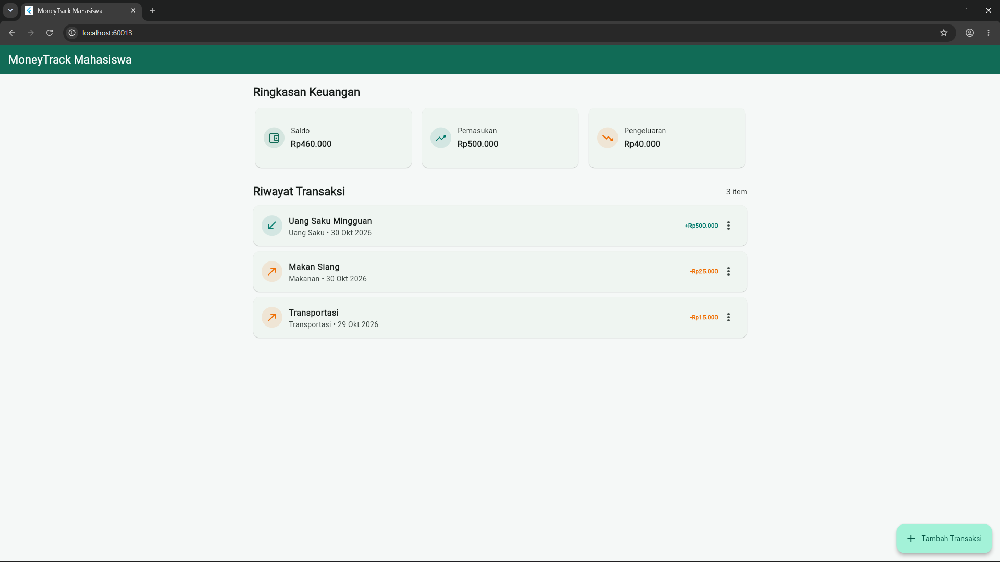
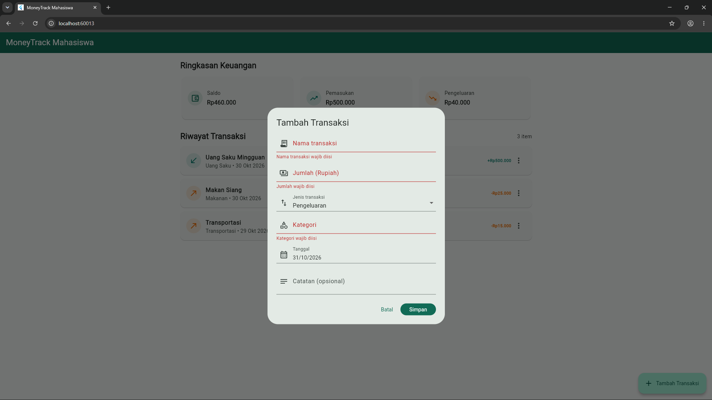
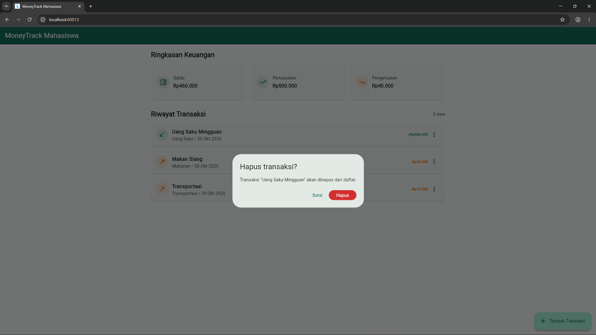

# UTS — Evaluasi Tengah Semester (Milestone M4)

| Identitas | Keterangan |
|:--|:--|
| Nama | Elangga Yudistira |
| NIM | 230660221109 |
| Kelas | SI-VIIA |
| Domain SI | Pengelolaan keuangan pribadi mahasiswa |
| Judul aplikasi | MoneyTrack Mahasiswa |

## Deskripsi project

MoneyTrack Mahasiswa membantu mahasiswa mencatat pemasukan dan pengeluaran harian, membaca riwayat transaksi, dan memantau saldo. MVP menggunakan Flutter dengan data lokal di memori. Pengguna dapat menambah, melihat, mengubah, dan menghapus transaksi dengan konfirmasi.

## Berkas pengumpulan UTS

| Berkas | Isi |
|:--|:--|
| [tes-konsep-uts.md](tes-konsep-uts.md) | Jawaban Soal 1–10 tes konsep UTS |
| [laporan-progress-uts.md](laporan-progress-uts.md) | Identitas, ringkasan project, ketercapaian M1–M3, matriks kebutuhan, kendala, rencana M5, refleksi, dan deklarasi AI |
| [screenshot-daftar.png](screenshot-daftar.png) | Halaman utama dan daftar transaksi |
| [screenshot-form.png](screenshot-form.png) | Form transaksi dan validasi input |
| [screenshot-hapus.png](screenshot-hapus.png) | Dialog konfirmasi hapus transaksi |

## Bukti milestone M1–M3

| Milestone | Artefak |
|:--|:--|
| M1 — Kebutuhan | [Dokumen kebutuhan](../../tugas-4/230660221109-ElanggaYudistira/dokumen-kebutuhan.md) dan [sumber user flow](../../tugas-4/230660221109-ElanggaYudistira/user-flow.mmd) |
| M2 — UI/UX dan navigasi | [Arsitektur informasi](../../tugas-5/230660221109-ElanggaYudistira/information-architecture.md), [wireframe](../../tugas-5/230660221109-ElanggaYudistira/wireframe.png), [alur navigasi](../../tugas-6/230660221109-ElanggaYudistira/navigation-flow.md), dan [kode form](../../tugas-6/230660221109-ElanggaYudistira/form-interaksi.dart) |
| M3 — MVP awal | [Model data](../../tugas-7/230660221109-ElanggaYudistira/model-data.md), [kode CRUD lokal](../../tugas-7/230660221109-ElanggaYudistira/crud-lokal.dart), dan [catatan keputusan data](../../tugas-7/230660221109-ElanggaYudistira/catatan-keputusan-data.md) |

## Menjalankan demo Flutter Web

Gunakan proyek Flutter dengan target web, lalu salin isi `crud-lokal.dart` dari Tugas 7 ke `lib/main.dart`. Dari direktori proyek Flutter tersebut, jalankan perintah berikut.

```powershell
flutter pub get
flutter run -d chrome
```

Periksa alur tambah transaksi, daftar riwayat, ubah melalui menu item, dan konfirmasi hapus. Data lokal tersedia selama sesi aplikasi berjalan dan kembali ke data awal ketika aplikasi dimulai ulang.

## Tangkapan layar

### Halaman daftar



### Form dan validasi



### Konfirmasi hapus



## Deklarasi penggunaan AI

ChatGPT membantu menyusun README revisi ini dan memeriksa tautan ke artefak pengumpulan. Rincian bantuan AI pada project dan laporan tercantum pada [laporan progress UTS](laporan-progress-uts.md#29-deklarasi-penggunaan-ai).
