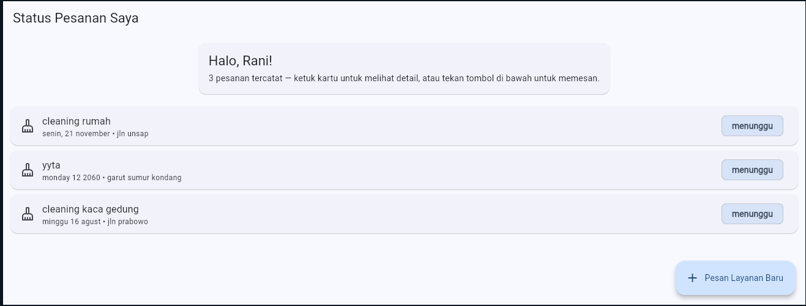
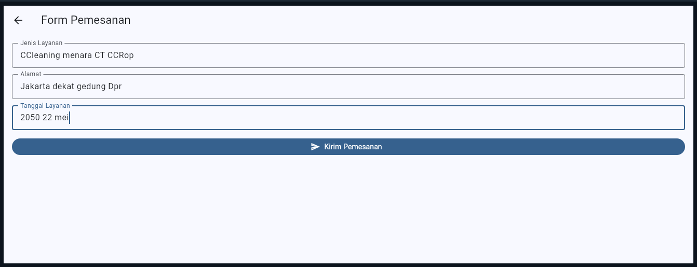
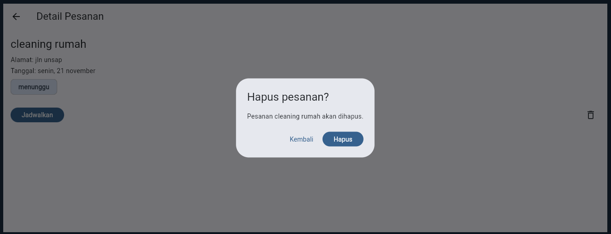

# Laporan Progress Project UTS (Milestone M4)

| | |
|:--|:--|
| **Nama** | Fajar |
| **NIM** | 230660221093 |
| **Kelas** | SI-VIIA |
| **Domain SI** | Usaha mikro jasa glass cleaning & nanocoating (Glazent.pro) |
| **Judul Aplikasi** | Glazent.pro — Pemesanan & Pelacakan Layanan |
| **Tautan Repository** | https://github.com/fajar230660221093/fajar230660221093 |

---

## 1. Ringkasan Eksekutif Project

Glazent.pro adalah usaha jasa glass cleaning dan nanocoating yang permintaannya tumbuh cepat lewat branding Instagram, tetapi masih dijalankan tanpa sistem informasi apa pun. Pemesanan, penjadwalan teknisi, serta riwayat dan garansi pekerjaan belum tercatat secara sistematis, sehingga pelanggan tidak dapat memantau status pesanannya sendiri. Aplikasi ini menyelesaikan masalah tersebut dengan memungkinkan pelanggan memesan layanan dan memantau statusnya, serta memungkinkan teknisi melihat tugas dan menandai pekerjaan selesai.

Pengguna utamanya adalah pelanggan (persona Rani) dan teknisi lapangan (persona Dimas). Solusi mobile dipilih karena pelanggan datang dari media sosial di ponsel dan memesan dalam sesi singkat, teknisi bekerja berpindah-pindah lokasi (konteks bergerak), dan sinyal di lokasi kerja kadang lemah (konektivitas terbatas).

## 2. Ketercapaian Milestone (M1 s.d. M3)

| Milestone | Deliverable | Status (Selesai / Sebagian) | Catatan / Bukti |
|:----------|:------------|:----------------------------|:----------------|
| M1: Kebutuhan | Dokumen kebutuhan + User Flow | Selesai | `dokumen-kebutuhan.md` dan `user-flow.png` di Tugas 4: 2 persona, 8 kebutuhan fungsional, 3 nonfungsional, MoSCoW, user flow 10 langkah dan 2 keputusan |
| M2: UI/UX | Wireframe + Navigasi | Selesai | Tugas 5: `information-architecture.md`, `wireframe.png`, `halaman-utama.dart`, `catatan-keputusan-ui.md`. Tugas 6: `navigation-flow.md`, `form-interaksi.dart`, `catatan-keputusan-navigasi.md` |
| M3: MVP Awal | Model data + CRUD lokal | Selesai | `crud-lokal.dart` di Tugas 7: model `DataPesanan`, state `setState`, Create/Read/Update/Delete berjalan, hapus dengan konfirmasi. Catatan: data in-memory, persistensi belum diterapkan |

## 3. Matriks Kebutuhan ke Implementasi

| ID Kebutuhan | Deskripsi Kebutuhan | Prioritas MoSCoW | Halaman Pemenuh | Operasi Data Terkait | Status |
|:-------------|:--------------------|:----------------:|:----------------|:---------------------|:-------|
| F-01 | Pelanggan memesan layanan (jenis layanan, alamat, tanggal) | Must | Form Pemesanan | Create | Selesai |
| F-02 | Pelanggan melihat status pesanan terkini | Must | Status Pesanan Saya, Detail Pesanan | Read | Selesai |
| F-03 | Pelanggan melihat riwayat pekerjaan dan masa garansi | Should | Riwayat & Garansi (rencana) | Read | Belum |
| F-04 | Teknisi melihat daftar tugas harian | Must | Daftar pesanan yang sama (belum disaring per teknisi) | Read | Sebagian |
| F-05 | Teknisi mengunggah foto sebelum dan sesudah pengerjaan | Must | Detail Tugas (rencana) | Create (foto) | Belum |
| F-06 | Teknisi menandai pekerjaan selesai | Must | Detail Pesanan | Update | Selesai |
| F-07 | Pelanggan mencari layanan berdasarkan kategori | Could | Halaman utama + pencarian (rencana) | Read | Belum |
| F-08 | Pelanggan menerima notifikasi pengingat jadwal | Won't | — | — | Ditunda sesuai MoSCoW |
| (tanpa ID) | Pelanggan membatalkan pesanan yang salah isi | Tidak tercatat di Tugas 4 | Detail Pesanan | Delete | Selesai |

Keterangan:
- **F-04 Sebagian:** daftar tugas teknisi memakai daftar pesanan yang sama dengan pelanggan karena aplikasi belum memiliki login dan pemisahan peran.
- **F-05 Belum:** membutuhkan fitur kamera/file dan penyimpanan di server (Pertemuan 11 dan backend).
- **Delete tanpa ID:** operasi ini diimplementasikan karena CRUD wajib lengkap. Kebutuhannya belum ada di dokumen Tugas 4 dan perlu ditambahkan sebagai F-09 bila ingin formal.

## 4. Tangkapan Layar Aplikasi Berjalan

**1. Halaman utama / daftar data** — daftar pesanan hasil tambah (Create dan Read).

**2. Halaman form pengisian data dengan validasi** — pesan validator tampil pada field yang kosong.

**3. Dialog konfirmasi aksi** — konfirmasi sebelum pesanan dihapus (Delete).

## 5. Kendala dan Solusi Teknis

| No. | Kendala | Cara Mengatasinya |
|:---:|:--------|:------------------|
| 1 | `flutter run -d chrome` gagal dengan pesan "No pubspec.yaml file found" dan `main.dart` penuh garis merah di VS Code, karena file dijalankan dari folder pengumpulan tugas yang bukan project Flutter | Membuat project Flutter terpisah dengan `flutter create`, menyalin kode ke `lib/main.dart`, lalu menjalankannya dari folder project tersebut. Folder tugas hanya dipakai untuk pengumpulan |
| 2 | Setelah folder tugas diganti nama dan di-push, folder lama masih tampil di GitHub sehingga ada folder ganda | Penghapusan folder harus ikut di-commit. Perintah `git add .` dari dalam subfolder tidak mencatat penghapusan di luar folder itu, sehingga saya memakai `git add -A` dari folder utama repository, lalu commit dan push |
| 3 | `flutter doctor` menampilkan tanda X pada Android toolchain dan peringatan pada Visual Studio, sementara laptop yang dipakai berspesifikasi lama | Karena tugas hanya menyasar target web, saya tetap memakai `flutter run -d chrome` dan tidak memasang Android Studio. Kedua peringatan tidak menghalangi |
| 4 | Layar form dan detail membutuhkan akses ke daftar pesanan, padahal route bernama pada Tugas 6 tidak mudah membawa fungsi | Layar daftar dijadikan pemilik state, lalu mengirim callback (`onKirim`, `onUbahStatus`, `onHapus`) lewat konstruktor dengan `MaterialPageRoute`, sesuai pola materi Pertemuan 7 |

## 6. Rencana Pengembangan Milestone M5 (REST API)

Pada Minggu 9–10, data pesanan yang sekarang disimpan in-memory akan diambil dari dan disimpan ke server melalui REST API, sehingga pelanggan, teknisi, dan pemilik membaca data yang sama dan data tidak hilang saat aplikasi ditutup. Model `DataPesanan` akan dilengkapi `fromJson` dan `toJson`, dan setiap layar akan menangani keadaan loading dan error.

Layanan backend yang dibutuhkan (rencana):

| Kebutuhan | Endpoint (rencana) | Keterangan |
|:----------|:-------------------|:-----------|
| Daftar dan pembuatan pesanan (F-01, F-02) | `GET /pesanan`, `POST /pesanan` | Menggantikan `_daftar` dan `tambahPesanan` |
| Ubah status (F-06) dan penjadwalan | `PATCH /pesanan/{id}/status` | Penjadwalan menjadi tugas pemilik di sisi server, sesuai Tugas 4 |
| Pembatalan pesanan | `DELETE /pesanan/{id}` | Menggantikan `removeWhere` |
| Katalog layanan (F-07) | `GET /layanan` | Mendukung pencarian per kategori |
| Riwayat dan garansi (F-03) | `GET /garansi` | Masa berlaku garansi dihitung di server |
| Foto bukti (F-05) | `POST /pesanan/{id}/foto` | Berpasangan dengan fitur kamera |
| Pemisahan peran (NF-03) | Autentikasi pelanggan, teknisi, pemilik | Data pesanan hanya terlihat oleh pemiliknya |

## 7. Refleksi Pembelajaran Tengah Semester

Saya memahami bahwa tampilan Flutter dibangun dari susunan widget, dan halaman daftar pesanan harus berupa `StatefulWidget` karena datanya berubah saat pesanan ditambah, diubah, atau dihapus. `setState` wajib dipanggil setiap data berubah agar tampilan ikut diperbarui. Tantangan terbesar bagi saya adalah menjaga dokumen kebutuhan, rancangan, dan kode tetap konsisten, misalnya operasi Delete yang ternyata belum punya kebutuhan F-xx di Tugas 4. Pada integrasi REST API nanti, saya ingin memastikan setiap kebutuhan sudah dipikirkan sampai ke operasi datanya sebelum menulis kode.

## 8. Deklarasi Penggunaan AI

Deklarasi penggunaan AI: Claude (Anthropic) — membantu menyusun kerangka dokumen, diagram, kode Flutter, dan draf laporan pada Tugas 1–7 serta laporan progress ini berdasarkan domain Glazent.pro; perbaikan kode, pengujian, dan penjelasan dilakukan serta diverifikasi oleh penulis.
