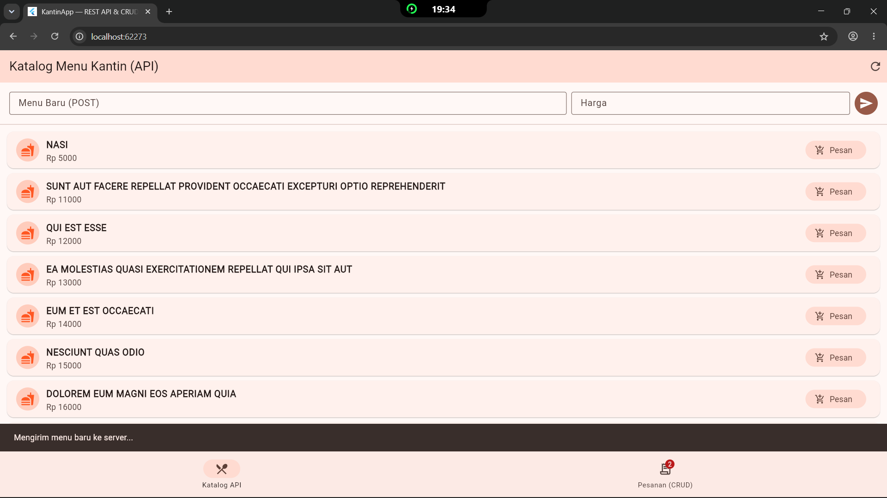
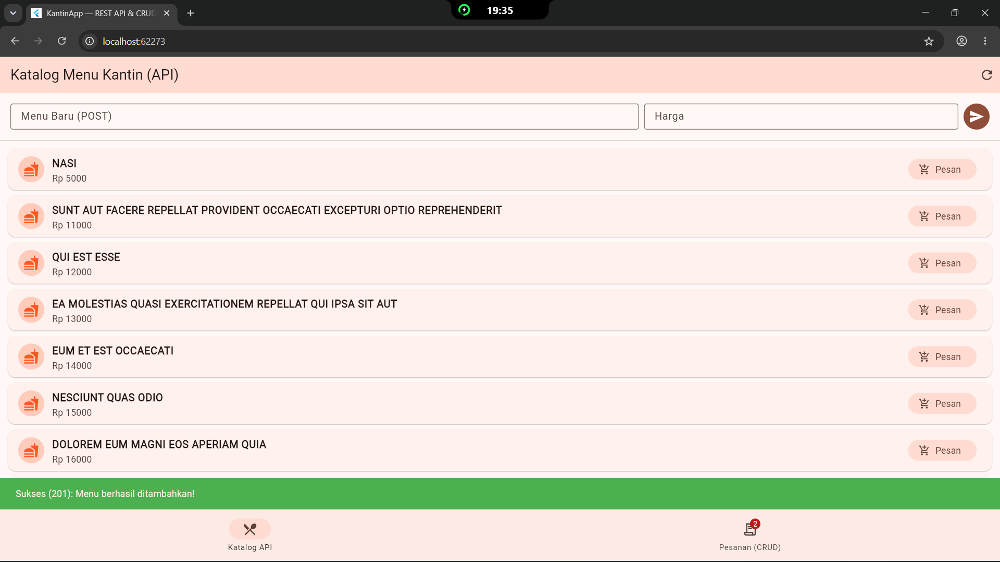
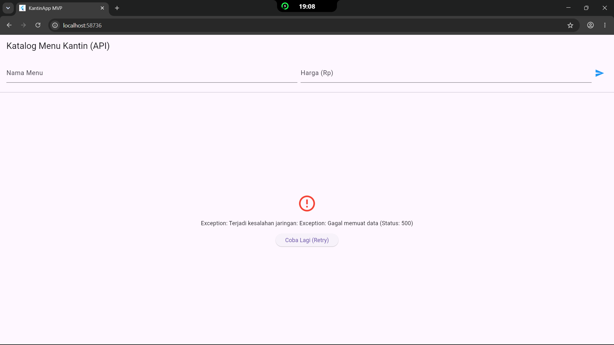

# Tugas 9 — Implementasi Konsumsi REST API pada Flutter

**Nama:** Muhammad Aulia Ramadhani  
**NIM:** 230660221013  
**Kelas:** SI-VIIA-Mobile  
**Domain Sistem Informasi:** Pemesanan Kantin Kampus  

Repositori ini berisi implementasi konsumsi REST API (metode `GET` dan `POST`) menggunakan package `http` pada Flutter yang terintegrasi dengan modul pemesanan kantin kampus.

## Daftar Berkas
- `service-api.dart` — Model data `MenuKantin` (`fromJson`) dan layanan `ApiService` (`fetchMenu` & `tambahMenu`).
- `halaman-api.dart` — Antarmuka daftar menu (kondisi *loading*, *sukses*, *error* + tombol *retry*) dan form pengiriman menu baru (`POST`).
- `catatan-integrasi-api.md` — Dokumentasi teknis endpoint API, struktur model, serta strategi penanganan error.
- `screenshot-loading.png`, `screenshot-sukses.png`, `screenshot-error.png` — Bukti tangkapan layar eksekusi aplikasi.

## Bukti Tangkapan Layar
| Kondisi Loading | Kondisi Sukses | Kondisi Error (Offline / URL Salah) |
|:---:|:---:|:---:|
|  |  |  |

## Refleksi Pembelajaran
Mengimplementasikan konsumsi REST API pada Flutter memberikan pemahaman nyata tentang bagaimana aplikasi mengelola komunikasi data secara asinkron menggunakan `Future` dan `FutureBuilder`. Saya mempelajari bahwa pengalaman pengguna sangat bergantung pada penanganan tiga kondisi antarmuka—yaitu indikator *loading*, tampilan data saat sukses, dan pesan *error* yang informatif beserta tombol *retry*. Selain itu, penerapan `try-catch`, validasi kode status HTTP, dan batas waktu *timeout* memastikan aplikasi tetap tangguh saat menghadapi gangguan jaringan.

## Deklarasi Penggunaan AI
Deklarasi penggunaan AI: AI digunakan sebagai asisten pemrograman untuk membantu menyusun struktur awal `ApiService`, template `FutureBuilder`, dan penyelarasan logika penampung lokal hasil `POST`, sedangkan integrasi domain Kantin Kampus, pengujian skenario jaringan, serta penyusunan refleksi dilakukan secara mandiri.
